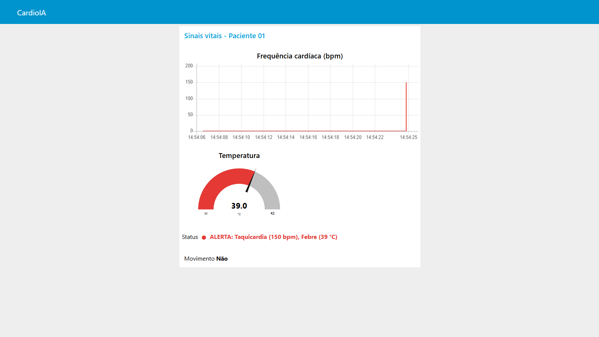
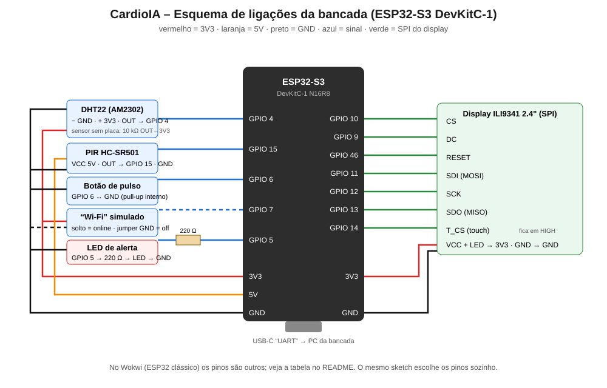

# CardioIA Conectada

Projeto desenvolvido no âmbito da FIAP para monitoramento, análise e inteligência em saúde cardiovascular.

## 📌 Visão Geral
O **CardioIA Conectada** integra dispositivos, telemetria clínica e modelos inteligentes para apoiar a detecção precoce e acompanhamento de condições cardíacas.

---
*Repositório sincronizado e configurado via SSH.*

## Fase 3 – Monitoramento Contínuo (IoT)

| Pasta | Conteúdo |
|---|---|
| [`fase3/wokwi/`](fase3/wokwi/) | `sketch.ino`, `diagram.json`, `libraries.txt` (cole os 3 em um projeto **ESP32** novo no Wokwi; o mesmo sketch roda no ESP32-S3 da bancada) |
| [`fase3/node-red/flow.json`](fase3/node-red/flow.json) | Dashboard (requer `node-red-dashboard`) |
| [`fase3/docker-compose.yml`](fase3/docker-compose.yml) | Lab local: broker Mosquitto + Node-RED + simulador de sinais |
| [`fase3/painel/`](fase3/painel/) | Painel web extra (React + Gauge do 21st.dev), lê o MQTT via WebSocket |
| [`fase3/docs/`](fase3/docs/) | Relatórios da Parte 1 (Edge) e da Parte 2 (MQTT + dashboard) |

**Link do projeto Wokwi:** https://wokwi.com/projects/479325303590176769

| Circuito (Wokwi) | Dashboard Node-RED em alerta |
|---|---|
|  |  |

### Lab local (Docker)

```bash
cd fase3
docker compose --profile sim up -d --build
```

- Dashboard Node-RED (entrega): http://localhost:1880/ui · Editor: http://localhost:1880. Ele tem alerta automático: o LED de status fica vermelho e aparece uma notificação na tela sempre que surge um alerta novo.
- Painel web (extra): http://localhost:8080
- O simulador publica sinais falsos a cada 2 s; pare-o com `docker compose stop simulador` quando o ESP32 real estiver ligado.
- ESP32 na bancada: aponte `MQTT_HOST` do firmware para o IP deste PC na rede local (porta 1883 liberada no firewall do Windows).
- **Wokwi → lab:** o ESP32 do Wokwi publica no HiveMQ público e o Mosquitto local tem uma ponte (`docker/mosquitto.conf`) que traz só `cardioia/g7f3a/#` (o prefixo do grupo) para o lab. Node-RED e painel funcionam sem mudar nada.

### Teste automatizado (Wokwi CLI)

Roda a simulação nos servidores do Wokwi, em velocidade real, e executa o roteiro [`cenario-teste.yaml`](fase3/wokwi/cenario-teste.yaml): online → offline → febre → pulso rápido → reconexão com rajada.

```bash
cd fase3/wokwi
pio run -e esp32dev
WOKWI_CLI_TOKEN=<seu token> wokwi-cli --scenario cenario-teste.yaml --serial-log-file serial.log .
```

O token é gerado em https://wokwi.com/dashboard/ci.

### Bancada (ESP32-S3 DevKitC-1 N16R8)

O mesmo `sketch.ino` roda na placa real. Os pinos mudam sozinhos conforme a placa (`#if CONFIG_IDF_TARGET_ESP32S3`).



| Componente | Pino do componente | ESP32-S3 (bancada) | ESP32 (Wokwi) |
|---|---|---|---|
| **Display ILI9341 2.4"** | VCC / LED | 3V3 | 3V3 |
| | GND | GND | GND |
| | CS | GPIO 10 | GPIO 5 |
| | RESET | GPIO 46 | GPIO 22 |
| | DC | GPIO 9 | GPIO 4 |
| | SDI (MOSI) | GPIO 11 | GPIO 23 |
| | SCK | GPIO 12 | GPIO 18 |
| | SDO (MISO) | GPIO 13 | GPIO 19 |
| | T_CS (touch, não usado) | GPIO 14, mantido em HIGH | – |
| **DHT22 (AM2302)** | VCC | 3V3 | 3V3 |
| | DATA | GPIO 4 (pull-up 10 kΩ p/ 3V3 se for o sensor sem placa) | GPIO 15 |
| | GND | GND | GND |
| **PIR HC-SR501** | VCC | 5V | 5V |
| | OUT | GPIO 15 | GPIO 27 |
| | GND | GND | GND |
| **Botão de pulso** | terminal 1 | GPIO 6 (pull-up interno) | GPIO 26 |
| | terminal 2 | GND | GND |
| **"Wi-Fi" (simulado)** | botão **BOOT** da própria placa (GPIO 0), sem fio | cada toque alterna online/offline | chave deslizante no GPIO 25 |
| **LED de alerta** | ânodo (perna longa) | GPIO 5 via resistor 220 Ω | GPIO 2 |
| | cátodo | GND | GND |

```
                 ESP32-S3 DevKitC-1
              ┌──────────────────────┐
  DHT22 DATA ─┤ GPIO4         GPIO10 ├─ CS   ┐
  LED+220Ω  ──┤ GPIO5         GPIO9  ├─ DC   │
  Botão     ──┤ GPIO6         GPIO11 ├─ MOSI │ ILI9341
  (livre)    ─┤ GPIO7         GPIO12 ├─ SCK  │ (SPI)
  PIR OUT   ──┤ GPIO15        GPIO13 ├─ MISO │
              │               GPIO46 ├─ RST  ┘
              │               GPIO14 ├─ T_CS (HIGH)
  DHT22/TFT ──┤ 3V3              5V  ├─ PIR VCC
  todos     ──┤ GND             GND  ├─ todos
              └──────────┬───────────┘
                    USB (porta UART)
```

Na bancada não há chave deslizante: o **botão BOOT** da placa faz esse papel. Um toque deixa a placa offline (as amostras vão para o buffer) e outro toque reconecta (o buffer é enviado em rajada).

**Gravar a placa (no PC da bancada):**

1. Copie `fase3/wokwi/secrets.example.h` para `secrets.h` (fica fora do git) e preencha a rede **2,4 GHz** e o `MQTT_HOST` com o IP do PC que roda o lab Docker. O ESP32 e esse PC precisam estar na mesma rede.
2. Grave e abra o monitor serial:

```bash
cd fase3/wokwi
pio run -e esp32s3 -t upload -t monitor
```

No serial devem aparecer `[MQTT] conectado` e as linhas `[CLOUD] {...}`. Nesse momento o dashboard do PC do lab começa a receber os dados. Com o lab Docker de pé, as mensagens aparecem no dashboard. As evidências de uma execução estão em [`fase3/docs/evidencias/`](fase3/docs/evidencias/). O `platformio.ini` também tem o ambiente `esp32s3`, usado para gravar o firmware na bancada.
