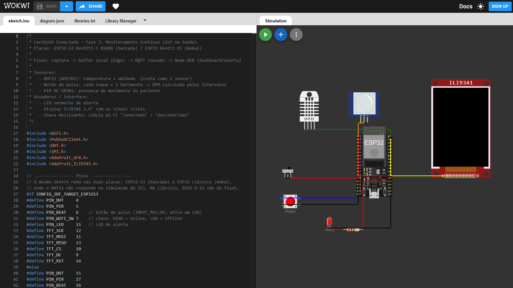
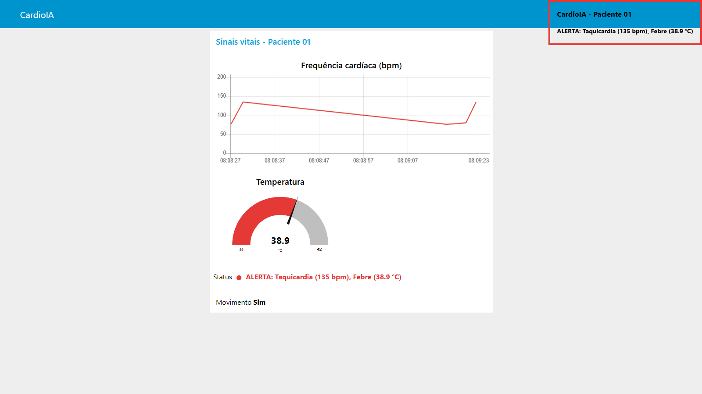
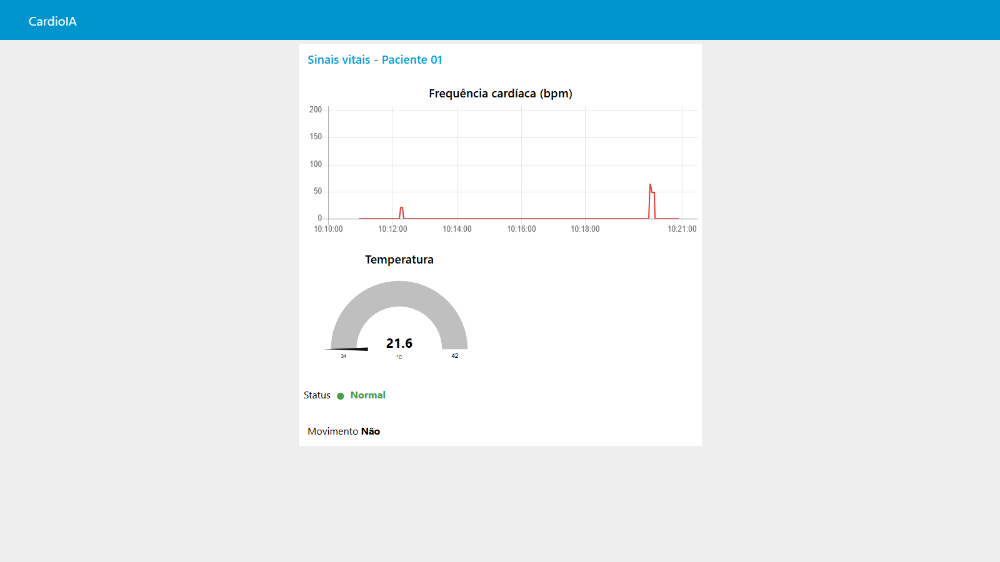
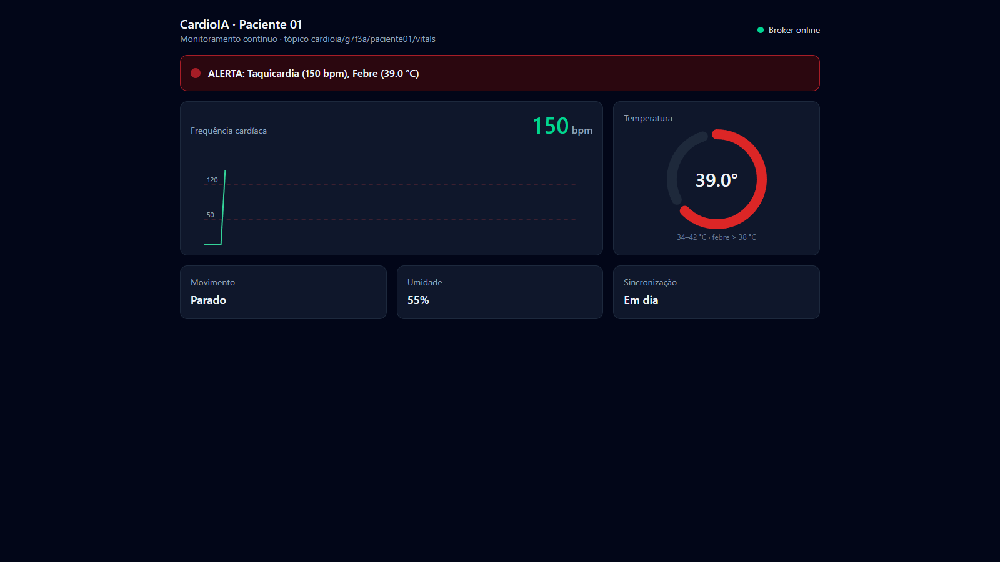
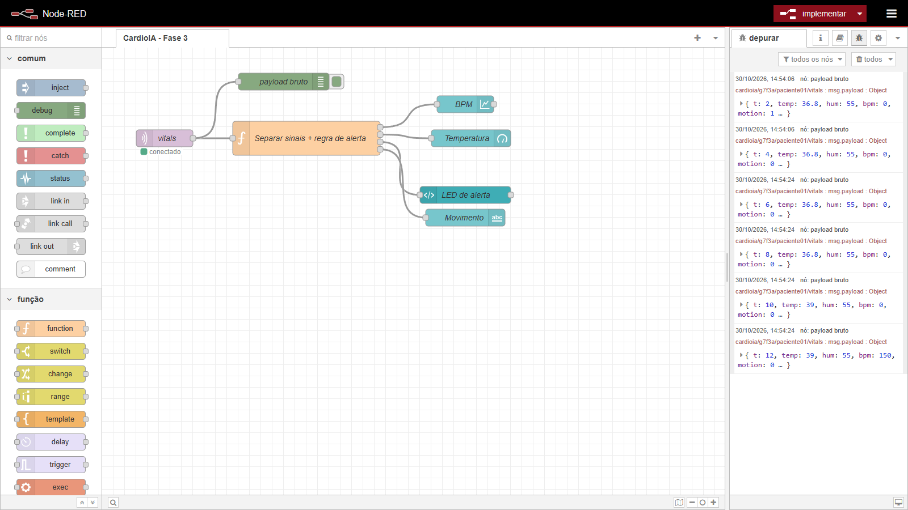
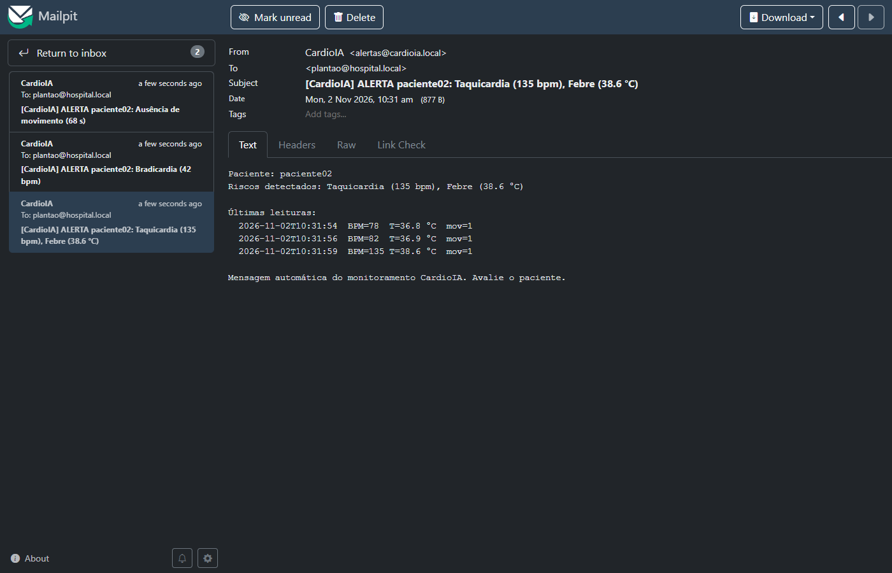
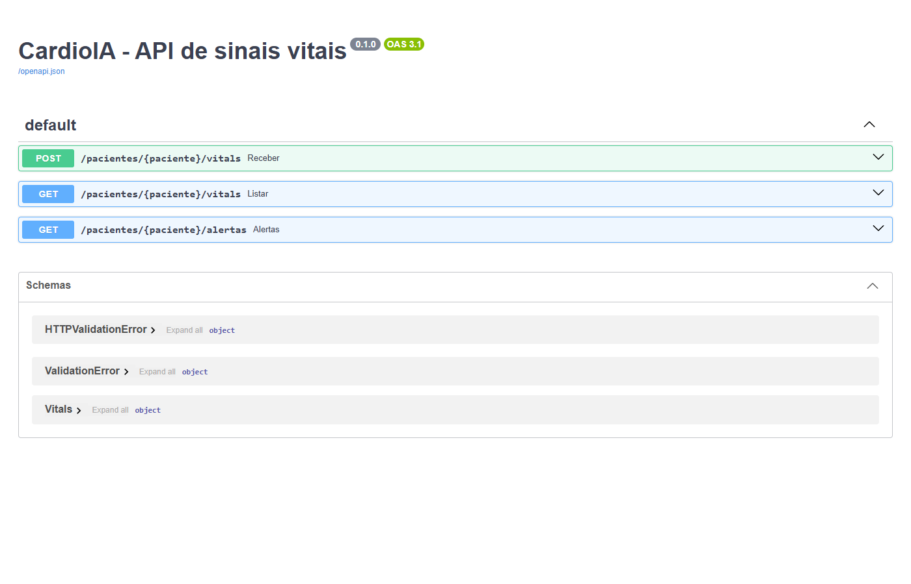
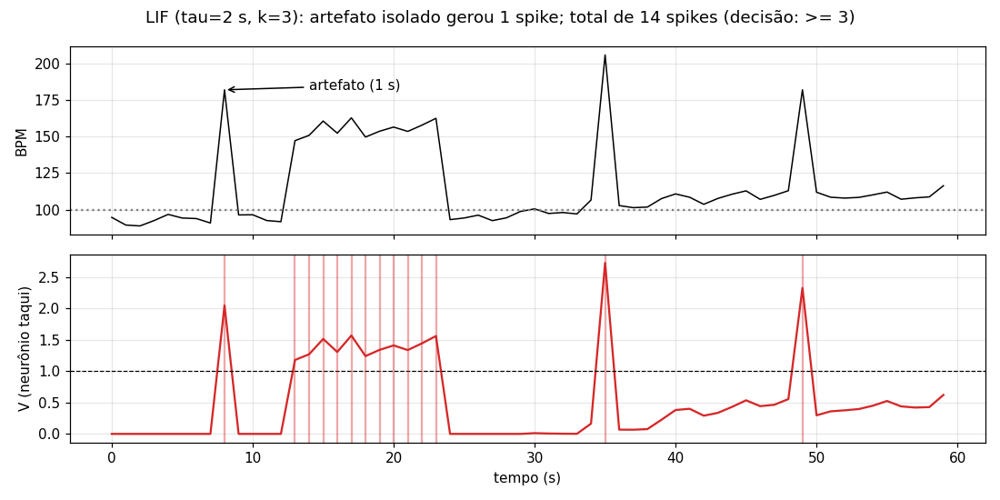
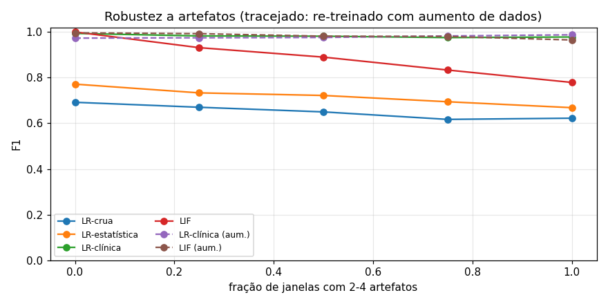

# FIAP - Faculdade de Informática e Administração Paulista

<p align="center">
<a href="https://www.fiap.com.br/">
  
</a>
</p>

<br>

# CardioIA Conectada – Fase 3: Monitoramento Contínuo (IoT na Saúde)

## 2TIAOR-2026

## 👨‍🎓 Integrantes:
- Giovani Saavedra – RM566797
- Marcio Elifas – RM567871

## 👩‍🏫 Professores:
### Tutor(a)
- Leonardo Ruiz Orabona
### Coordenador(a)
- André Godoi Chiovatto


## 📜 Descrição

O **CardioIA Conectada** é o protótipo funcional de um **vestível de monitoramento cardíaco**. Ele captura sinais vitais, mantém os dados seguros quando a internet cai, transmite tudo para a nuvem via MQTT e exibe as informações em um dashboard com **alertas automáticos**. A solução integra as três camadas da IoT em saúde.

**Edge Computing – ESP32 (Parte 1).** Um ESP32 simulado no Wokwi, e validado também em um **ESP32-S3 real na bancada**, lê três sensores:
- **DHT22:** temperatura e umidade;
- **botão de pulso:** cada toque é um batimento, e o BPM é calculado pelo intervalo entre os toques;
- **PIR:** movimento do paciente.

A regra de alerta é decidida no próprio dispositivo: **BPM > 120** (taquicardia), **BPM < 50** (bradicardia), **temperatura > 38 °C** (febre) ou **60 s sem movimento** (possível queda). Quando há alerta, o LED e o display sinalizam mesmo sem rede.

A conectividade Wi-Fi é simulada por uma variável booleana: no Wokwi, uma chave deslizante; na bancada, o botão BOOT. Toda leitura passa por um **buffer circular de 3600 amostras**, o que dá 2 horas de autonomia offline. Quando a rede volta, as amostras são sincronizadas **em ordem cronológica**, cada uma registrada no Serial com `[CLOUD]`. Uma amostra só sai do buffer depois que o envio dá certo, então uma queda no meio da sincronização não perde dados.

**Fog e Cloud – MQTT + Node-RED (Parte 2).**
- O ESP32 publica um JSON a cada 2 s no tópico `cardioia/g7f3a/paciente01/vitals`.
- O Wokwi usa o broker público **HiveMQ**. Um **Mosquitto local** (Docker) faz uma ponte que traz só o prefixo do grupo, e a placa real publica direto nele.
- O **dashboard Node-RED** mostra o gráfico de BPM, o medidor de temperatura e o LED de status com o motivo do alerta. Ele também emite uma **notificação automática** a cada alerta novo e revalida as regras clínicas, sem depender só do dispositivo.
- Um **painel web em React** consome o mesmo tópico. Isso mostra que novos consumidores entram sem alterar o firmware.

**Segurança e LGPD.** O relatório discute o risco real observado no broker público: dados de outras equipes estavam visíveis no mesmo prefixo. A mitigação adotada foi a **pseudonimização** do tópico (`g7f3a`/`paciente01`) com a ponte restrita. O caminho para produção é **TLS, autenticação por dispositivo e ACL por tópico**.

**Ir Além.**
- **(1)** Uma **API REST em Python** (FastAPI) avalia o risco de cada amostra. Um cliente REST consome a API (POST e GET) e dispara **e-mails de alerta** para uma caixa de teste (Mailpit), sem enviar nada para a internet.
- **(2)** Um **notebook de IA** compara **regressão logística** e uma **rede neuromórfica LIF** em séries de frequência cardíaca, avaliando desempenho, robustez a artefatos de sensor e latência de detecção.

Todo o ambiente sobe com um único `docker compose up`, e os testes são reprodutíveis: cenário automatizado no **Wokwi CLI**, logs e prints em `fase3/docs/evidencias`.


## 📁 Estrutura de pastas

Dentre os arquivos e pastas presentes na raiz do projeto, definem-se:

- <b>fase3/docs</b>: documentação textual.
  - Relatórios da [Parte 1 – Edge](fase3/docs/relatorio-parte1-edge.md) e da [Parte 2 – MQTT e dashboard](fase3/docs/relatorio-parte2-mqtt-dashboard.md).
  - [Esquema de ligações da bancada](fase3/docs/esquema-bancada.svg).
  - Prints e logs de evidência, em [`evidencias/`](fase3/docs/evidencias/).

- <b>fase3/wokwi</b>: código-fonte do ESP32.
  - `sketch.ino`, em C++ comentado; o mesmo arquivo roda no Wokwi e no ESP32-S3.
  - `diagram.json` e `libraries.txt`, do projeto Wokwi.
  - `platformio.ini`, para compilar.
  - `cenario-teste.yaml`, o teste automatizado.
  - `secrets.example.h`, o modelo de credenciais da bancada.

- <b>fase3/node-red</b>: fluxo do dashboard (`flow.json`), para importar no Node-RED.

- <b>fase3/painel</b>: painel web extra (React + Vite), que lê o MQTT via WebSocket.

- <b>fase3/docker</b> e <b>fase3/docker-compose.yml</b>: laboratório local com broker Mosquitto (com a ponte para o HiveMQ), Node-RED, painel, API, cliente REST, Mailpit e o simulador opcional.

- <b>fase3/ir-alem-1</b>: **Ir Além 1**, API REST, lógica de risco e automação de e-mail ([README](fase3/ir-alem-1/README.md)).

- <b>fase3/ir-alem-2</b>: **Ir Além 2**, notebook de IA comparando regressão logística e LIF ([README](fase3/ir-alem-2/README.md)).

- <b>assets</b>: imagens do README.

- <b>README.md</b>: guia e explicação geral do projeto (este arquivo).


## 📎 Links e Observações

- <b>Listagem de Links</b>:
  - Projeto no Wokwi: https://wokwi.com/projects/479325303590176769
  - Vídeo do Ir Além 2 (YouTube, não listado): https://youtu.be/gQoTYg0JhG8
  - Relatórios:
    - [Parte 1 – Edge Computing](fase3/docs/relatorio-parte1-edge.md)
    - [Parte 2 – MQTT e dashboard](fase3/docs/relatorio-parte2-mqtt-dashboard.md)
    - [Ir Além 1 – REST e e-mail](fase3/docs/relatorio-ir-alem-1-rest-email.md)
    - [Ir Além 2 – IA em séries temporais](fase3/docs/relatorio-ir-alem-2-ia.md)

- <b>Explicação de decisões técnicas</b>:
  - **Buffer em RAM, e não SPIFFS:** no simulador, o SPIFFS é volátil, como o próprio enunciado aponta. O buffer circular em RAM guarda 3600 amostras (2 h) e descarta a mais antiga quando enche. O Monitor Serial serve como registro da resiliência.
  - **Dois brokers:** o Wokwi roda na nuvem e só alcança brokers na internet (HiveMQ). O Mosquitto local atende a placa real e o dashboard, e a ponte (`fase3/docker/mosquitto.conf`) importa apenas `cardioia/g7f3a/#`.
  - **Tópico com código do grupo:** no broker público, outras equipes publicavam sob `cardioia/`. O prefixo exclusivo evita misturar dados, e os identificadores pseudonimizados atendem à LGPD.
  - **Regra revalidada no Node-RED:** a central não confia apenas no firmware do dispositivo.
  - **Automação de e-mail em Python, e não no Node-RED:** o Node-RED alerta quem está na tela, e o cliente Python alerta quem não está (plantão). Os dois são independentes.

- <b>Observações Gerais</b>: o projeto não está relacionado a nenhuma competição.

### 🖼 Evidências

**Partes 1 e 2: simulação, dashboard e bancada**

| Circuito no Wokwi | Dashboard Node-RED em alerta |
|---|---|
|  |  |
| **Notificação automática de alerta** | **Dashboard com o ESP32-S3 real (bancada)** |
|  |  |
| **Painel web extra (React) em alerta** | **Debug do Node-RED: rajada do buffer offline** |
|  |  |

**[Ir Além 1](fase3/ir-alem-1/README.md): API REST e e-mail de alerta** ([relatório](fase3/docs/relatorio-ir-alem-1-rest-email.md))

| E-mail de alerta disparado automaticamente | API REST (Swagger) |
|---|---|
|  |  |

**[Ir Além 2](fase3/ir-alem-2/README.md): regressão logística × rede neuromórfica LIF** ([notebook](fase3/ir-alem-2/cardioia_lif_vs_logistica.ipynb) · [relatório](fase3/docs/relatorio-ir-alem-2-ia.md))

| Neurônio LIF: membrana e spikes | Robustez a artefatos de sensor |
|---|---|
|  |  |


## 🔧 Como executar o código

### Pré-requisitos

- [Docker Desktop](https://www.docker.com/products/docker-desktop/), para o laboratório local.
- **Opcional, para compilar o firmware:**
  - [PlatformIO](https://platformio.org/) (`pip install platformio`) ou Arduino IDE 2 com o pacote *esp32* 3.x;
  - bibliotecas PubSubClient, DHT sensor library, Adafruit Unified Sensor, Adafruit GFX e Adafruit ILI9341.
- **Opcional, para o teste automatizado:** [Wokwi CLI](https://docs.wokwi.com/wokwi-ci/getting-started), com o token gerado em https://wokwi.com/dashboard/ci.
- **Opcional, para o notebook do Ir Além 2:** Python 3.11+ com `numpy`, `scikit-learn`, `matplotlib` e `jupyter`.

### 1. Simulação no Wokwi

Abra https://wokwi.com/projects/479325303590176769 e clique em ▶. Para testar:

1. **Online:** toque o botão "Pulso" várias vezes. O BPM aparece no display e no Serial.
2. **Offline:** mude a chave para offline. O `buffer=` cresce no Serial.
3. **Alerta:** ajuste o DHT22 para 39 °C. O LED acende e a tela fica vermelha, mesmo offline.
4. **Reconexão:** volte a chave para online. A rajada `[CLOUD]` aparece e o buffer volta a 0.

Para reproduzir em outro projeto, copie os arquivos `sketch.ino`, `diagram.json` e `libraries.txt` de `fase3/wokwi/` para um projeto **ESP32** novo.

### 2. Laboratório local (Docker)

```bash
git clone https://github.com/marcioelifas/CardioIA-Conectada.git
cd CardioIA-Conectada/fase3
docker compose up -d --build                 # acrescente --profile sim para gerar dados falsos sem ESP32
```

**Arquitetura: o caminho de cada leitura**

```
 ESP32 (Wokwi) ──MQTT──▶ HiveMQ (broker público, internet) ──ponte──┐
                                                                    ▼
 ESP32-S3 (bancada) ──────────────MQTT─────────────────────▶ Mosquitto (broker local)
                                                                    │
                       ┌────────────────────────┬───────────────────┼──────────────────────┐
                       ▼                        ▼                   ▼                      ▼
                   Node-RED                  Painel             cliente-rest ──REST──▶   API
              (dashboard + alerta)        (React, extra)             │               (risco, histórico)
                                                                     └──SMTP──▶ Mailpit (e-mail de alerta)
```

**Por que dois brokers?**
- O Wokwi roda nos servidores dele, na internet, e não enxerga o seu PC. Por isso publica no **HiveMQ público**.
- O **Mosquitto** local tem uma **ponte**: copia do HiveMQ só o tópico do grupo (`cardioia/g7f3a/#`) para o lab. Assim, a simulação na nuvem e a placa real alimentam o mesmo dashboard, sem mudar nada no Node-RED.

**O que roda em cada container:**

| Container | O que faz | Endereço |
|---|---|---|
| `mosquitto` | Broker MQTT local, o "correio" do sistema. Recebe da placa e, pela ponte, do Wokwi, e entrega a todos os consumidores | `localhost:1883` (WebSocket na porta 9001) |
| `node-red` | **Dashboard da entrega:** gráfico de BPM, medidor de temperatura, LED de status e notificação automática. Revalida as regras clínicas | http://localhost:1880/ui · editor em http://localhost:1880 |
| `painel` | Painel web extra (React). Mostra os mesmos dados com visual de monitor hospitalar, lendo direto do MQTT | http://localhost:8080 |
| `api` | **Ir Além 1:** API REST em FastAPI. Recebe cada amostra, avalia o risco e guarda o histórico | http://localhost:8000/docs |
| `cliente-rest` | **Ir Além 1:** automação. Leva cada amostra do MQTT para a API e envia e-mail quando surge um alerta novo | `docker compose logs -f cliente-rest` |
| `mailpit` | **Ir Além 1:** caixa de e-mail de teste. Recebe os alertas e mostra numa página; nada sai para a internet | http://localhost:8025 |
| `simulador` | Opcional (`--profile sim`). Gera sinais vitais falsos quando não há placa nem Wokwi | – |

Com a simulação do Wokwi rodando, o dashboard já recebe os dados, porque a ponte traz tudo automaticamente.

### 3. Teste automatizado (Wokwi CLI)

Roda a simulação nos servidores do Wokwi, em velocidade real, e executa o roteiro [`cenario-teste.yaml`](fase3/wokwi/cenario-teste.yaml): online → offline → febre → pulso rápido → reconexão com rajada.

```bash
cd fase3/wokwi
pio run -e esp32dev
WOKWI_CLI_TOKEN=<seu token> wokwi-cli --scenario cenario-teste.yaml --serial-log-file serial.log .
```

### 4. Bancada (ESP32-S3 DevKitC-1 N16R8, opcional)

O mesmo `sketch.ino` roda na placa real, e os pinos mudam automaticamente conforme a placa.


| Componente | Pino do componente | ESP32-S3 (bancada) | ESP32 (Wokwi) |
|---|---|---|---|
| **Display ILI9341 2.4"** | VCC / LED | 3V3 | 3V3 |
| | GND | GND | GND |
| | CS | GPIO 10 | GPIO 5 |
| | RESET | GPIO 46 | GPIO 22 |
| | DC | GPIO 9 | GPIO 4 |
| | SDI (MOSI) | GPIO 11 | GPIO 23 |
| | SCK | GPIO 12 | GPIO 18 |
| | SDO (MISO) | GPIO 13 | GPIO 19 |
| | T_CS (touch, não usado) | GPIO 14, mantido em HIGH | – |
| **DHT22 (AM2302)** | VCC | 3V3 | 3V3 |
| | DATA | GPIO 4 (pull-up 10 kΩ p/ 3V3 se for o sensor sem placa) | GPIO 15 |
| | GND | GND | GND |
| **PIR HC-SR501** | VCC | 5V | 5V |
| | OUT | GPIO 15 | GPIO 27 |
| | GND | GND | GND |
| **Botão de pulso** | terminal 1 | GPIO 6 (pull-up interno) | GPIO 26 |
| | terminal 2 | GND | GND |
| **"Wi-Fi" (simulado)** | botão **BOOT** da própria placa (GPIO 0), sem fio | cada toque alterna online/offline | chave deslizante no GPIO 25 |
| **LED de alerta** | ânodo (perna longa) | GPIO 5 via resistor 220 Ω | GPIO 2 |
| | cátodo | GND | GND |

**Gravação:**

1. Copie `fase3/wokwi/secrets.example.h` para `secrets.h`, que fica fora do git. Preencha:
   - a rede Wi-Fi de **2,4 GHz**, com o nome exatamente igual ao do roteador;
   - o `MQTT_HOST`, com o IP do PC que roda o lab Docker. Os dois precisam estar na mesma rede.
2. Grave a placa:
   - **PlatformIO:** `cd fase3/wokwi && pio run -e esp32s3 -t upload -t monitor`.
   - **Arduino IDE:** use a placa **ESP32S3 Dev Module** com *USB CDC On Boot: Enabled*, Flash de 16 MB e PSRAM OPI. O `secrets.h` deve estar na mesma pasta do `.ino`.
3. No Serial Monitor (115200), devem aparecer `[MQTT] conectado` e as linhas `[CLOUD] {...}`. A partir daí, o dashboard recebe os dados.
4. Para testar a resiliência, toque o botão **BOOT**: a placa fica offline e o buffer cresce. Toque de novo: ela reconecta e o buffer é enviado em rajada.

### 5. Ir Além

- **Ir Além 1 (API REST + e-mail):** já sobe junto com o lab Docker. Veja o [README](fase3/ir-alem-1/README.md).
- **Ir Além 2 (notebook de IA):** `cd fase3/ir-alem-2 && pip install -r requirements.txt && jupyter notebook`. Veja o [README](fase3/ir-alem-2/README.md).


## 🗃 Histórico de lançamentos

* 1.0.0 - 02/11/2026
    * README no padrão FIAP e consolidação da entrega
* 0.5.0 - 02/11/2026
    * Ir Além 1: API REST com lógica de risco e alerta por e-mail (Mailpit)
    * Ir Além 2: notebook comparando regressão logística e rede neuromórfica LIF
* 0.4.0 - 02/11/2026
    * Validação na bancada com ESP32-S3 real (buffer offline e rajada em hardware)
    * Notificação automática de alerta no dashboard Node-RED e esquema de ligações
* 0.3.0 - 30/10/2026
    * Teste automatizado no Wokwi CLI, tópico exclusivo do grupo e ponte restrita
    * Relatórios da Parte 1 e da Parte 2 com prints e logs
* 0.2.0 - 27/10/2026
    * Firmware Edge com buffer offline e laboratório Docker (Mosquitto, Node-RED e painel)
* 0.1.0 - 18/10/2026
    * Estrutura inicial do repositório

---


## 📋 Licença

<p xmlns:cc="http://creativecommons.org/ns#" xmlns:dct="http://purl.org/dc/terms/"><a property="dct:title" rel="cc:attributionURL" href="https://github.com/SabrinaOtoni/TEMPLATE-FIAP-GRAD-ON-IA">MODELO GIT FIAP</a> por <a rel="cc:attributionURL dct:creator" property="cc:attributionName" href="https://fiap.com.br">FIAP</a> está licenciado sobre <a href="http://creativecommons.org/licenses/by/4.0/?ref=chooser-v1" target="_blank" rel="license noopener noreferrer" style="display:inline-block;">Attribution 4.0 International</a>.</p>
