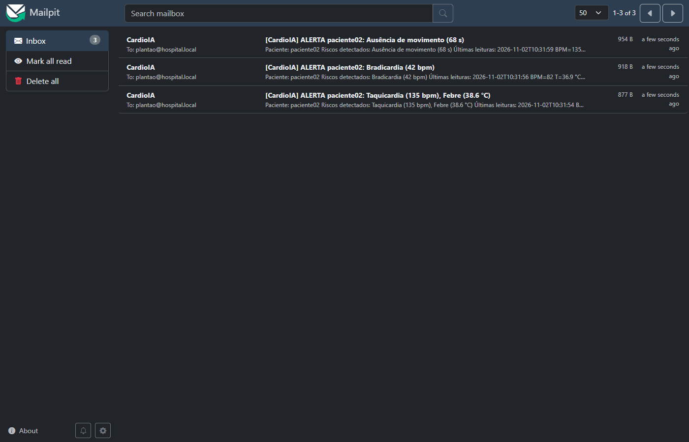
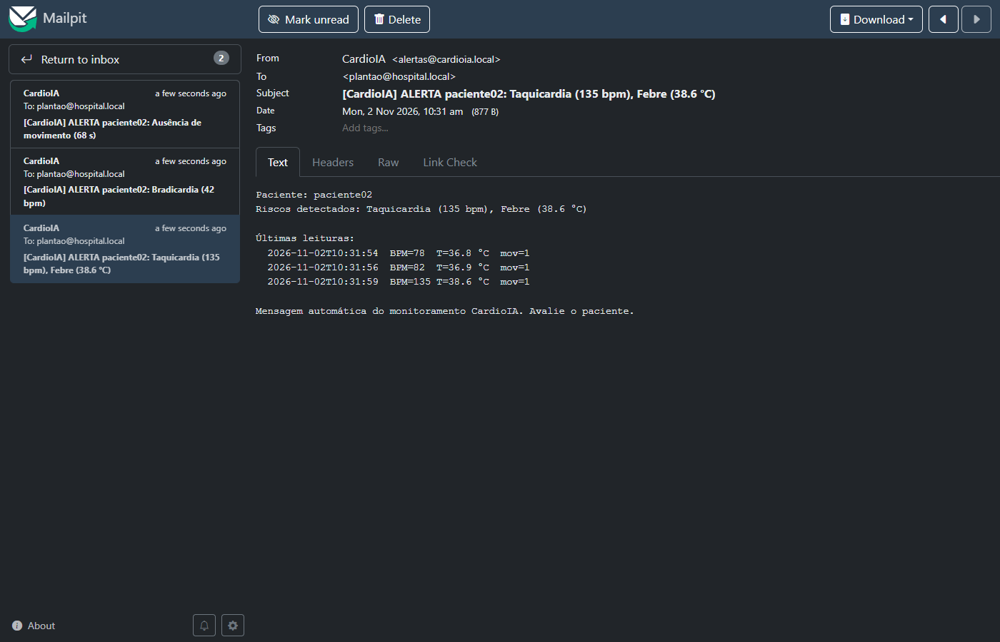
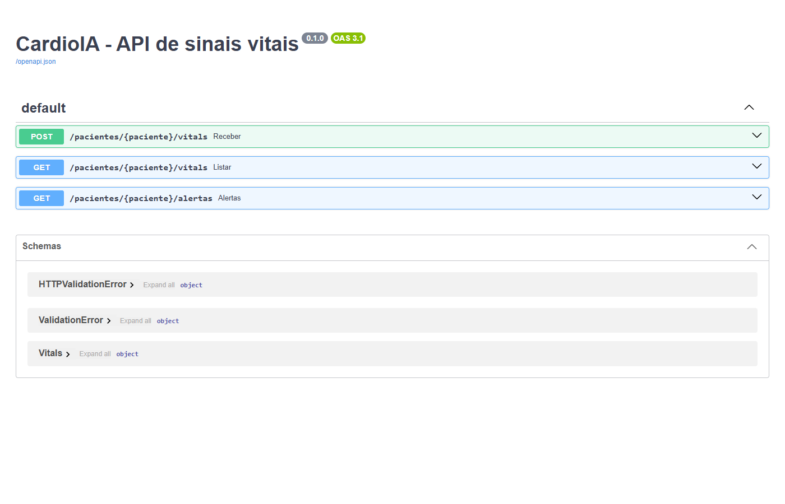

# Relatório – Ir Além 1: Comunicação automatizada com REST e e-mail

**Projeto:** CardioIA Conectada – Fase 3
**Código:** [`ir-alem-1/`](../ir-alem-1/) · `api.py` (API REST) · `cliente.py` (cliente REST + automação de e-mail) · `risco.py` (lógica de risco)

## 1. Fluxo implementado

```
 ESP32 / Wokwi ──MQTT──▶ Mosquitto ──MQTT──▶ cliente.py ──POST /pacientes/{id}/vitals──▶ api.py
                                               │  ◀── {"risco": true, "riscos": [...]} ───┘   (avalia com risco.py)
                                               │
                                               ├─ alerta novo? ── GET /pacientes/{id}/vitals?limite=5 ──▶ api.py
                                               │                    (últimas leituras para o corpo do e-mail)
                                               └─ SMTP ──▶ Mailpit (caixa de entrada de teste, http://localhost:8025)
```

1. O ESP32 publica cada amostra no MQTT, no mesmo tópico já usado pelo dashboard (`cardioia/g7f3a/<paciente>/vitals`).
2. O **cliente REST** (`cliente.py`) assina `cardioia/g7f3a/+/vitals`, ou seja, todos os pacientes, e envia cada amostra para a API com **POST**.
3. A **API REST** (`api.py`, FastAPI) guarda a amostra no histórico do paciente, aplica a lógica de risco e devolve o resultado na própria resposta.
4. Se a resposta traz um **alerta novo**, o cliente consulta a API com **GET** para buscar as 5 últimas leituras e **dispara o e-mail** de alerta para o plantão.

Assim, o cliente consome a API nos dois sentidos: envia dados (POST) e recebe dados (a resposta do POST e o GET do histórico), como pede o enunciado.

**Por que a automação está em Python e não no Node-RED?** O Node-RED também conseguiria chamar a API e mandar e-mail (nós `http request` e `e-mail`). A separação, porém, foi intencional:

- **Papéis diferentes.** O Node-RED (Parte 2) é a camada de visualização: alerta **quem está olhando a tela** (LED e notificação no dashboard). O cliente Python é a automação no estilo RPA: alerta **quem não está olhando** (e-mail para o plantão) e alimenta o histórico da API. É a mesma divisão de um hospital, onde o monitor do leito apita e um sistema separado aciona o plantonista.
- **Independência.** Como os dois assinam o mesmo tópico MQTT de forma independente, se o dashboard cair o e-mail continua saindo, e vice-versa. Nenhum depende do outro.
- **Código testável e versionado.** A regra de risco fica em uma função Python (`risco.py`) com autoteste, mais fácil de revisar e testar do que uma lógica espalhada em nós visuais. O enunciado do Ir Além 1 também pede explicitamente um cliente REST em Python.

## 2. API REST

| Método | Rota | Função |
|---|---|---|
| POST | `/pacientes/{paciente}/vitals` | Recebe uma amostra (JSON igual ao do ESP32), avalia e devolve `{"risco": bool, "riscos": [...]}` |
| GET | `/pacientes/{paciente}/vitals?limite=20` | Últimas amostras do paciente, já com os riscos calculados |
| GET | `/pacientes/{paciente}/alertas?limite=20` | Só as amostras que tiveram algum risco |

- O corpo do POST é validado pelo modelo `Vitals` (Pydantic). Um JSON incompleto recebe resposta 422, e nada é gravado.
- A documentação interativa (Swagger) é gerada automaticamente em `http://localhost:8000/docs`, e dá para testar cada rota pelo navegador.
- O histórico fica em memória, com as últimas 1000 amostras por paciente. É suficiente para a demonstração; em produção, o lugar seria um banco de séries temporais.

## 3. Lógica de verificação de risco (`risco.py`)

Os limites são os mesmos do firmware e do Node-RED, para que as três camadas concordem:

| Risco | Regra |
|---|---|
| Taquicardia | BPM > 120 |
| Bradicardia | 0 < BPM < 50 (BPM 0 significa "sem leitura" e não gera alerta) |
| Febre | temperatura > 38,0 °C |
| Ausência de movimento | 60 s ou mais sem o PIR detectar movimento, medidos pelo campo `t` do próprio dispositivo |

- **Imobilidade:** a API guarda, por paciente, o instante `t` do último movimento. Se o `t` voltar a um valor menor, significa que o dispositivo reiniciou, e o relógio é zerado para não gerar um falso alerta.
- **Autoteste:** `python risco.py` executa asserts para cada regra. O teste também roda no build da imagem Docker, então, se uma regra quebrar, o container nem sobe.

## 4. Automação do e-mail (RPA)

- **Sem spam:** o e-mail só sai quando muda o **tipo** de risco. Uma taquicardia que passa de 135 para 138 bpm continua sendo o mesmo alerta e não gera outro e-mail. Quando o paciente volta ao normal, o envio é rearmado.
- **Conteúdo:** o assunto já traz o motivo, por exemplo `[CardioIA] ALERTA paciente02: Taquicardia (135 bpm), Febre (38.6 °C)`. O corpo traz as últimas leituras, para quem recebe ter contexto sem abrir o dashboard.
- **Envio simulado:** o SMTP usado é o **Mailpit**, um servidor de e-mail de teste que roda no Docker do lab. Ele aceita qualquer mensagem e mostra tudo em uma caixa de entrada web. Nenhum e-mail sai para a internet e não há senha de conta real no código. Para usar um servidor real, basta trocar `SMTP_HOST`/`SMTP_PORT` e acrescentar TLS e login (`smtp.starttls()` e `smtp.login()`).
- **Robustez:** se a API ou o SMTP estiverem fora do ar, o erro é registrado no log e o cliente continua rodando. A amostra seguinte tenta de novo.

## 5. Como executar

```bash
cd fase3
docker compose up -d --build        # sobe broker, Node-RED, painel, API, cliente REST e Mailpit
```

- API (Swagger): http://localhost:8000/docs
- Caixa de e-mail de teste: http://localhost:8025
- Log do cliente: `docker compose logs -f cliente-rest`

Os dados podem vir do ESP32 real, do Wokwi (pela ponte com o HiveMQ) ou do simulador (`--profile sim`).

## 6. Evidências

Sequência publicada para o `paciente02`: normal → taquicardia e febre → normal → bradicardia → imobilidade ([`evidencias/cliente-rest.log`](evidencias/cliente-rest.log)):

```
[API] paciente02 {"t":4,...,"bpm":82,...}  -> normal
[API] paciente02 {"t":6,"temp":38.6,...,"bpm":135,...} -> ['Taquicardia (135 bpm)', 'Febre (38.6 °C)']
[EMAIL] [CardioIA] ALERTA paciente02: Taquicardia (135 bpm), Febre (38.6 °C)
[API] paciente02 {"t":8,"temp":38.7,...,"bpm":138,...} -> ['Taquicardia (138 bpm)', 'Febre (38.7 °C)']   <- mesmo alerta, sem e-mail
[API] paciente02 {"t":10,...,"bpm":80,...} -> normal                                                    <- rearma
[API] paciente02 {"t":12,...,"bpm":42,...} -> ['Bradicardia (42 bpm)']
[EMAIL] [CardioIA] ALERTA paciente02: Bradicardia (42 bpm)
[API] paciente02 {"t":80,...,"motion":0,...} -> ['Ausência de movimento (68 s)']
[EMAIL] [CardioIA] ALERTA paciente02: Ausência de movimento (68 s)
```

Foram 3 alertas distintos e 3 e-mails, sem repetição. Durante os testes, a placa ESP32-S3 da bancada (`paciente01`) também disparou e-mails reais de "Ausência de movimento", porque ficou parada sobre a mesa.

**Caixa de entrada (Mailpit):**



**E-mail de alerta aberto:**



**API REST (Swagger):**


