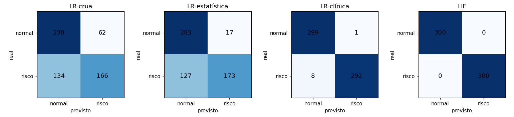
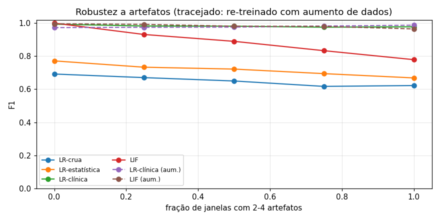
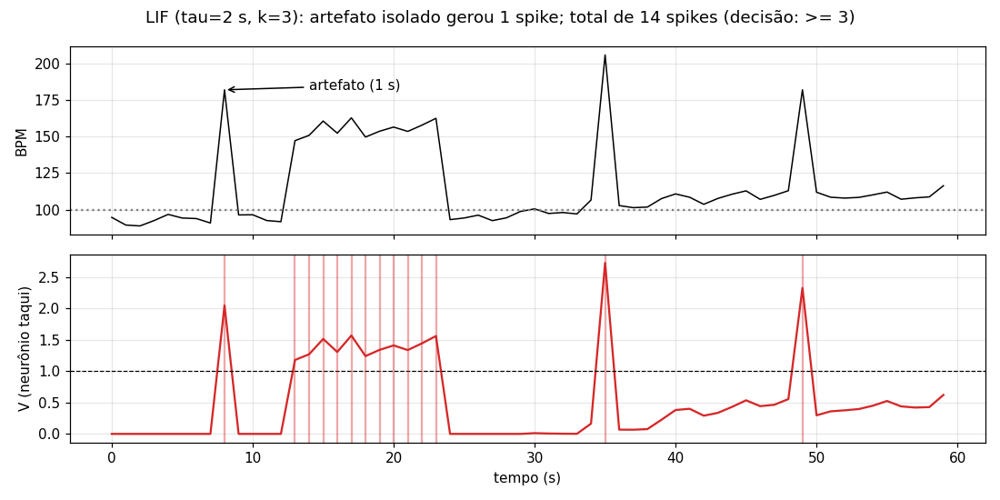

# Relatório – Ir Além 2: IA em séries temporais de frequência cardíaca

**Projeto:** CardioIA Conectada – Fase 3
**Notebook:** [`ir-alem-2/cardioia_lif_vs_logistica.ipynb`](../ir-alem-2/cardioia_lif_vs_logistica.ipynb)
**Vídeo:** ver o link no [README do Ir Além 2](../ir-alem-2/README.md)

## 1. Objetivo

A tarefa é detectar **risco cardíaco** em janelas de 60 s de frequência cardíaca (1 amostra/s), comparando duas abordagens:

- um **classificador tradicional:** regressão logística (LR);
- uma **rede neuromórfica simples:** dois neurônios *Leaky Integrate-and-Fire* (LIF).

Riscos considerados: taquicardia sustentada, bradicardia e crise paroxística (taquicardia curta, de 8 a 20 s).

## 2. Dados

Não existe base pública com o formato exato do dispositivo do projeto. Por isso, foram geradas **2000 janelas sintéticas** (semente fixa, reprodutível), metade normais e metade de risco, com:

- **Fisiologia:** frequência basal de 62–95 bpm, arritmia sinusal respiratória (oscilação de 4–6 s) e deriva lenta.
- **Negativos difíceis:** um terço das janelas normais tem esforço físico, que leva o BPM até 100–115 bpm sem caracterizar risco.
- **Artefatos de sensor:** 40 % das janelas, de qualquer classe, têm picos de +60 a +100 bpm durante 1 s, imitando um toque duplo no botão ou o sensor mal posicionado.
- **Ruído:** gaussiano de 2 bpm.

Divisão: 70 % treino e 30 % teste, estratificada por tipo.

## 3. Modelos

| Modelo | Entrada | O que aprende |
|---|---|---|
| **LR-crua** | as 60 amostras | 61 pesos |
| **LR-estatística** | média, desvio, mín., máx., p10, p90, RMSSD, inclinação | 9 pesos |
| **LR-clínica** | distância acima de 100 e abaixo de 60 bpm (média e pior trecho de 5 s) e fração do tempo fora da faixa | 7 pesos |
| **LIF** | 2 neurônios. Entrada: corrente proporcional ao excesso acima de 100 bpm (neurônio "taqui") e abaixo de 60 bpm ("bradi") | 3 hiperparâmetros ($\tau$, ganho $g$, mínimo de spikes $k$), por busca em grade |

**O neurônio LIF:**
- integra a corrente no potencial de membrana, que vaza com constante $\tau$: $\tau\,dV/dt = -V + I$;
- emite um *spike* ao atingir $V_{th} = 1$, e o potencial volta a zero;
- a janela é classificada como risco se a rede emitir pelo menos $k$ spikes.

A **LR-clínica** recebe exatamente o mesmo conhecimento de domínio que a codificação de entrada do LIF. Ela é a comparação justa: compara **modelo contra modelo**, e não "atributo bom" contra "atributo ruim".

## 4. Resultados

### 4.1 Base de teste (600 janelas)

| Modelo | Acurácia | Precisão | Recall | F1 | AUC |
|---|---|---|---|---|---|
| LR-crua | 0,673 | 0,728 | 0,553 | 0,629 | 0,675 |
| LR-estatística | 0,760 | 0,911 | 0,577 | 0,706 | 0,673 |
| LR-clínica | 0,985 | 0,997 | 0,973 | 0,985 | 1,000 |
| **LIF** (τ=2 s, g=1, k=3) | **1,000** | **1,000** | **1,000** | **1,000** | **1,000** |

Acerto por tipo de janela:

| Tipo | LR-crua | LR-estatística | LR-clínica | LIF |
|---|---|---|---|---|
| normal | 0,79 | 0,94 | 1,00 | 1,00 |
| taquicardia | 0,67 | 0,76 | 1,00 | 1,00 |
| **bradicardia** | **0,10** | **0,00** | 1,00 | 1,00 |
| paroxística | 0,91 | 0,99 | 0,92 | 1,00 |

### 4.2 Robustez a artefatos

Os modelos treinados foram avaliados em bases novas com **2 a 4 picos por janela**. A fração de janelas contaminadas variou de 0 a 100 %. Depois, LR-clínica e LIF foram **re-treinados com aumento de dados**: o treino original mais uma cópia com artefatos fortes.

| F1 com artefatos em… | 0 % | 50 % | 100 % |
|---|---|---|---|
| LR-clínica | 0,994 | 0,981 | 0,978 |
| LIF (τ=2, k=3) | 1,000 | 0,890 | **0,779** |
| LR-clínica (aumento de dados) | 0,973 | 0,976 | 0,988 |
| LIF (aumento de dados: τ=4, g=3, k=8) | 0,996 | 0,982 | 0,965 |

### 4.3 Latência de detecção online

Foram simulados 200 fluxos: 60 s normais seguidos de 30 s de taquicardia.
- A LR roda a cada segundo, sobre a janela dos últimos 60 s.
- O LIF processa amostra por amostra.

| Modelo | Mediana | p90 |
|---|---|---|
| LR-estatística | 6 s | 6 s |
| LR-clínica | 4 s | **18 s** |
| LIF (τ=2) | **3 s** | **5 s** |
| LIF (aumento de dados) | 7 s | 9 s |

## 5. Análise

1. **A representação pesa mais que o modelo.** Com atributos genéricos, a LR **não detecta bradicardia** (0–10 %). O risco é bimodal (BPM alto **ou** baixo), e uma única fronteira linear não separa as duas pontas: é um problema do tipo XOR. Com a codificação clínica, a LR salta para F1 = 0,985. O LIF, por construção, já tem um neurônio para cada ponta.
2. **O LIF aproveita a dimensão temporal.** Na base limpa, ele acerta 100 % das crises paroxísticas, contra 92 % da LR-clínica, porque integra o estímulo ao longo do tempo em vez de resumir a janela em médias.
3. **O dilema real é robustez × latência.**
   - Com τ curto, o LIF alerta em cerca de 3 s, mas cada artefato isolado também dispara um spike (figura abaixo). Com 4 artefatos, ele dá falso alarme.
   - Com aumento de dados, a busca escolheu τ e k maiores: a robustez volta (0,965), mas a latência sobe para 7 s.
   - A LR-clínica é robusta, porque usa médias, mas tem cauda longa de latência: p90 de 18 s.
   - No LIF, esse equilíbrio é **explícito e ajustável** (τ e k), uma vantagem para calibração clínica.
4. **Custo e energia.**
   - O LIF guarda 2 números de estado e faz cerca de 10 operações por amostra. A LR precisa da janela de 60 amostras e de centenas de operações a cada passo.
   - O LIF é orientado a eventos: com BPM normal, a entrada é zero. Isso favorece vestíveis com bateria e hardware neuromórfico (Loihi, SpiNNaker), e ele cabe no próprio ESP32 do projeto.
5. **Vantagens da LR:**
   - entrega **probabilidade calibrada** e pesos interpretáveis ("alertou porque passou X% do tempo acima de 100 bpm");
   - treina por otimização convexa, rápida e estável.

   O LIF entrega contagem de spikes, e o "treino" por busca em grade não escala. Redes maiores exigiriam *surrogate gradients* (snnTorch, Norse).

## 6. Limitações e próximos passos

- **Dados sintéticos:** as classes são bem separadas, e o 100 % do LIF reflete isso. Com dados reais, os números devem cair.
- **Próximo passo:** validar com séries reais do PhysioNet (MIT-BIH, *Normal Sinus Rhythm*) e com as leituras do ESP32 da bancada.
- **Ritmos irregulares**, como a fibrilação atrial, em que o BPM médio é normal, exigiriam outra codificação de entrada (por exemplo, a variabilidade entre batimentos).

## 7. Recomendação para o CardioIA

- **Edge (ESP32):** LIF re-treinado com artefatos, no lugar do limite fixo atual. É barato, robusto e tem o equilíbrio sensibilidade/falso alarme ajustável por τ e k.
- **Fog/Cloud (API do Ir Além 1):** LR-clínica, para entregar à equipe médica a probabilidade de risco e a explicação por atributo.
