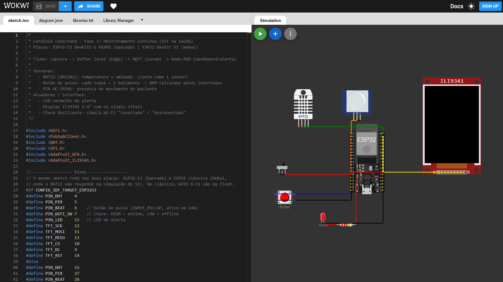
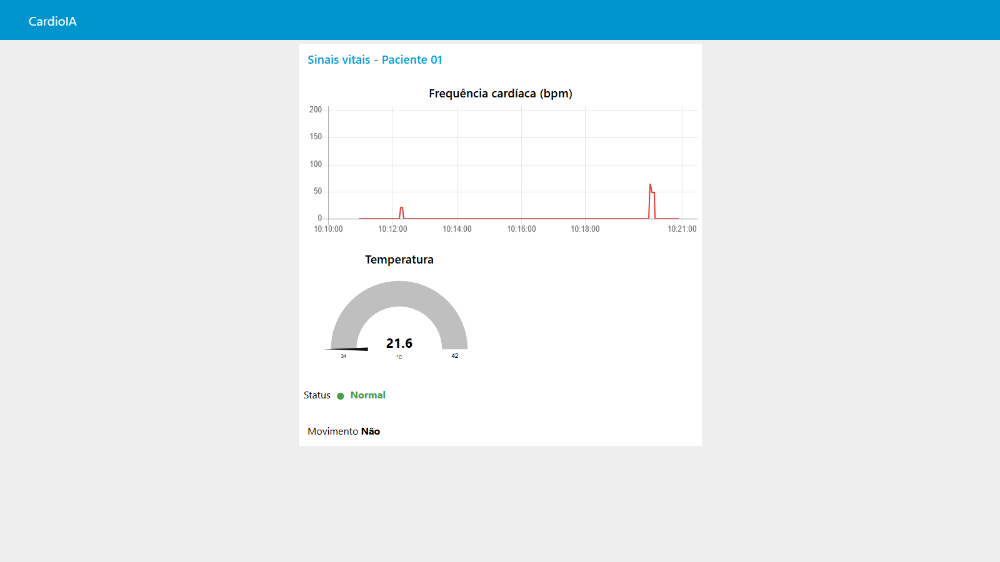
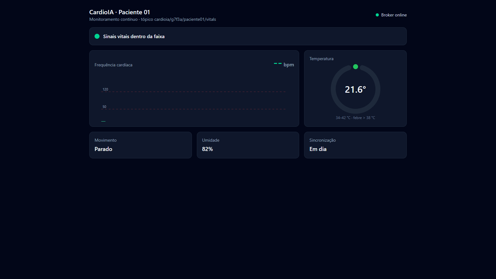

# Relatório – Parte 1: Armazenamento e Processamento Local (Edge Computing)

**Projeto:** CardioIA Conectada – Fase 3: Monitoramento Contínuo
**Plataforma:** ESP32 DevKit (simulado no Wokwi) · ESP32-S3 DevKitC-1 N16R8 (montagem em bancada)
**Código:** [`wokwi/sketch.ino`](../wokwi/sketch.ino) · **Simulação:** https://wokwi.com/projects/479325303590176769

## 1. Objetivo

Simular um dispositivo vestível de monitoramento cardíaco que continue funcionando sem internet. O dispositivo coleta sinais vitais, avalia riscos localmente e guarda as leituras até conseguir enviá-las para a nuvem. Esse é o papel do Edge Computing em saúde: a decisão crítica (o alerta) não pode depender da rede.

## 2. Sensores e componentes

| Componente | GPIO Wokwi (ESP32) | GPIO bancada (ESP32-S3) | Função |
|---|---|---|---|
| DHT22 (AM2302) | 15 | 4 | Temperatura corporal simulada e umidade do ambiente |
| Botão "Pulso" | 26 | 6 | Cada toque representa um batimento; o BPM é calculado pelos intervalos |
| PIR HC-SR501 | 27 | 5 | Detecta movimento do paciente |
| Chave deslizante | 25 | 7 | Simula a conectividade Wi-Fi (variável booleana `wifiOnline`) |
| LED vermelho + 220 Ω | 2 | 15 | Alerta local |
| Display ILI9341 2.4" (SPI) | CS 5, DC 4, RST 22, MOSI 23, SCK 18, MISO 19 | CS 10, DC 9, RST 14, MOSI 11, SCK 12, MISO 13 | Mostra sinais vitais, status de rede e ocupação do buffer |

O mesmo `sketch.ino` roda nas duas placas: os pinos são escolhidos em tempo de compilação (`#if CONFIG_IDF_TARGET_ESP32S3`). No Wokwi foi usado o ESP32 clássico porque, nos testes, o DHT22 não respondeu na simulação do ESP32-S3 (todas as leituras inválidas, com fiação e bibliotecas verificadas).



O DHT22 conta como um sensor (temperatura + umidade). O segundo sensor obrigatório é o botão de pulso, e o PIR é um terceiro sensor, que permite detectar a "ausência de movimento".

## 3. Fluxo de funcionamento

```
 loop() contínuo
   ├─ lê botão de pulso (detecção de borda + debounce de 250 ms)
   ├─ lê PIR (registra o último instante com movimento)
   ├─ atualiza conectividade (chave + Wi-Fi + MQTT)
   └─ a cada 2 s:
        1. lê DHT22 (leitura inválida → amostra descartada e registrada no Serial)
        2. calcula BPM = 60000 / média dos intervalos dos últimos 5 toques
        3. aplica as regras de alerta
        4. acende/apaga o LED de alerta   ← funciona offline
        5. grava a amostra no buffer local
        6. atualiza o display
   (a cada volta do loop, se online e com MQTT conectado → sincroniza o buffer,
    do mais antigo ao mais novo; assim a rajada sai assim que a conexão volta)
```

**Regras de alerta (processadas no próprio ESP32):**
- Febre: temperatura > 38,0 °C
- Taquicardia: BPM > 120
- Bradicardia: 0 < BPM < 50 (BPM 0 significa "sem leitura", não "coração parado")
- Ausência de movimento: mais de 60 s sem acionar o PIR

## 4. Lógica de resiliência offline

**Princípio:** toda leitura passa pelo buffer, esteja o dispositivo online ou não. Assim existe um único caminho de dados: online o buffer é esvaziado na hora, offline ele acumula. Não existe um "modo offline" separado que possa falhar.

**Armazenamento limitado (dimensionamento):**
- Taxa: 1 amostra a cada 2 s (30 por minuto)
- Capacidade: **3.600 amostras = 2 horas de autonomia offline**
- Cada amostra ocupa cerca de 12 bytes (tempo, temperatura ×10, umidade, BPM, movimento, alerta), o que dá cerca de 43 KB de RAM

**Por que 2 horas?** O cenário de negócio é um paciente em casa usando o vestível. Quedas de Wi-Fi domésticas costumam durar minutos. Duas horas cobrem com folga uma queda de energia ou uma saída do paciente para fora do alcance do roteador. No ESP32-S3 N16R8 real, os 8 MB de PSRAM permitem ampliar para mais de 500 mil amostras (cerca de 12 dias) sem mudar a lógica, só a constante `BUFFER_CAP`.

**Política quando o buffer enche:** buffer circular (FIFO). A amostra mais antiga é sobrescrita e o contador `descartadas` é incrementado e exibido no Serial. A escolha prioriza os dados recentes, que são os relevantes para a conduta clínica. O alerta não se perde, porque é sinalizado localmente pelo LED e pelo display no momento em que ocorre.

**Sincronização:** quando a chave volta para "online" e o MQTT conecta, `syncBuffer()` envia as amostras **do mais antigo para o mais novo**, preservando a ordem temporal. Cada amostra só é removida do buffer **depois** que o `publish` retorna sucesso. Se a conexão cair no meio da sincronização, o envio para e o restante continua guardado. Cada envio também é impresso via `Serial.println("[CLOUD] ...")`, como pede o enunciado.

## 5. SPIFFS e limitação do simulador

O SPIFFS é volátil no Wokwi: os dados se perdem ao encerrar a simulação. Por isso o buffer foi implementado em RAM, e o Monitor Serial serve como registro da resiliência (linhas `[EDGE]` com o tamanho do buffer e `[CLOUD]` na sincronização). No chip físico, a evolução natural é gravar o mesmo buffer em LittleFS/SPIFFS: o ESP32-S3 N16R8 tem 16 MB de flash, o que permite persistir os dados mesmo após uma reinicialização.

## 6. Como testar no Wokwi

1. Inicie a simulação com a chave em **online** e toque em "Pulso" repetidamente. O BPM aparece no display e no Serial.
2. Mude a chave para **offline**. O Serial mostra `buffer=` crescendo e o display mostra "OFFLINE".
3. Ajuste a temperatura do DHT22 para 39 °C. O LED acende e a tela fica vermelha, mesmo offline.
4. Volte a chave para **online**. O Serial mostra a rajada de linhas `[CLOUD]` e o buffer volta a 0.

**Teste automatizado:** o mesmo roteiro está em [`wokwi/cenario-teste.yaml`](../wokwi/cenario-teste.yaml) e roda no Wokwi CLI, em velocidade real (`pio run -e esp32dev` para compilar, depois `wokwi-cli --scenario cenario-teste.yaml`). O cenário derruba a rede, sobe a temperatura para 39 °C, toca o pulso a cada 400 ms e religa a rede, conferindo cada etapa no Serial.

## 7. Evidência (Monitor Serial, execução do cenário)

Log completo em [`evidencias/serial-wokwi.log`](evidencias/serial-wokwi.log):

```
[NET] online (chave=1, wifi=1)
[MQTT] conectado
[CLOUD] {"t":2,"temp":36.8,"hum":55,"bpm":0,"motion":1,"alert":0,"pending":1}
[CLOUD] {"t":4,"temp":36.8,"hum":55,"bpm":0,"motion":0,"alert":0,"pending":0}
[NET] offline (chave=0, wifi=1)
[EDGE] T=36.8 H=55 BPM=0 MOV=0 ALERTA=0 buffer=1 descartadas=0 offline
[EDGE] T=36.8 H=55 BPM=0 MOV=0 ALERTA=0 buffer=2 descartadas=0 offline
[EDGE] T=39.0 H=55 BPM=0 MOV=0 ALERTA=1 buffer=3 descartadas=0 offline    <- febre, alerta local sem rede
[EDGE] T=39.0 H=55 BPM=150 MOV=0 ALERTA=1 buffer=4 descartadas=0 offline  <- taquicardia
[NET] online (chave=1, wifi=1)
[MQTT] conectado
[CLOUD] {"t":6,"temp":36.8,...,"alert":0,"pending":3}                      <- rajada, do mais antigo
[CLOUD] {"t":8,"temp":36.8,...,"alert":0,"pending":2}
[CLOUD] {"t":10,"temp":39.0,...,"alert":1,"pending":1}
[CLOUD] {"t":12,"temp":39.0,"hum":55,"bpm":150,...,"alert":1,"pending":0}
```

O alerta foi disparado offline (LED e tela), as 4 amostras ficaram no buffer e foram enviadas em ordem cronológica assim que a conexão voltou, com `pending` caindo até 0.

## 8. Validação em hardware real (bancada, ESP32-S3)

O mesmo firmware foi gravado em um **ESP32-S3 DevKitC-1 N16R8** com DHT22, PIR, botão de pulso, LED e display ILI9341 reais. O esquema de ligações está no [README](../../README.md#bancada-esp32-s3-devkitc-1-n16r8). Diferenças em relação ao Wokwi:

- **Rede:** Wi-Fi 2,4 GHz do laboratório. A placa publica direto no Mosquitto do PC do lab, e o SSID, a senha e o IP do broker ficam em `secrets.h`, fora do git.
- **"Wi-Fi" simulado:** a placa não tem chave deslizante. O botão **BOOT** (GPIO 0) faz esse papel: um toque deixa a placa offline e outro reconecta.

**Resultado** ([`evidencias/broker-bancada.log`](evidencias/broker-bancada.log), horário de chegada no broker):

```
10:19:34 {"t":100,"temp":21.6,"hum":82,"bpm":0,"motion":1,"alert":0,"pending":0}
10:19:36 {"t":102,"temp":21.6,"hum":82,"bpm":0,"motion":1,"alert":0,"pending":0}
                                                   <- BOOT: offline por 17 s
10:19:53 {"t":104,"temp":21.6,"hum":82,"bpm":0,"motion":1,"alert":0,"pending":7}   <- BOOT: rajada
10:19:53 {"t":106,...,"pending":6}
   ...
10:19:54 {"t":118,"temp":21.6,"hum":82,"bpm":0,"motion":1,"alert":0,"pending":0}
10:19:54 {"t":120,"temp":21.6,"hum":82,"bpm":0,"motion":0,"alert":0,"pending":0}   <- volta ao normal
```

- **Leituras reais:** temperatura ambiente de 21,6 °C e umidade de 82 % no DHT22, movimento detectado pelo PIR e BPM gerado pelo botão.
- **Buffer offline:** as 8 amostras coletadas sem rede (t = 104 a 118 s) chegaram em cerca de 1 s após a reconexão, em ordem e sem perda, com `pending` caindo de 7 a 0.
- **Alerta de imobilidade:** em outra execução, a placa ficou mais de 60 s sem detectar movimento e publicou `"alert":1` com BPM 0. É o alerta de possível queda ou inconsciência, disparado só pelo Edge.
- **Lições da bancada:** o nome da rede precisa ser exatamente igual ao do roteador (maiúsculas, hífen). Para facilitar o diagnóstico, cada linha `[EDGE]` do Serial passou a mostrar o estado da chave, o código do `WiFi.status()` e o do MQTT. Além disso, se o DHT22 se solta, a amostra é descartada (`[DHT] leitura inválida`) e o display deixa de atualizar.

| Dashboard Node-RED com a placa real | Painel web |
|---|---|
|  |  |
