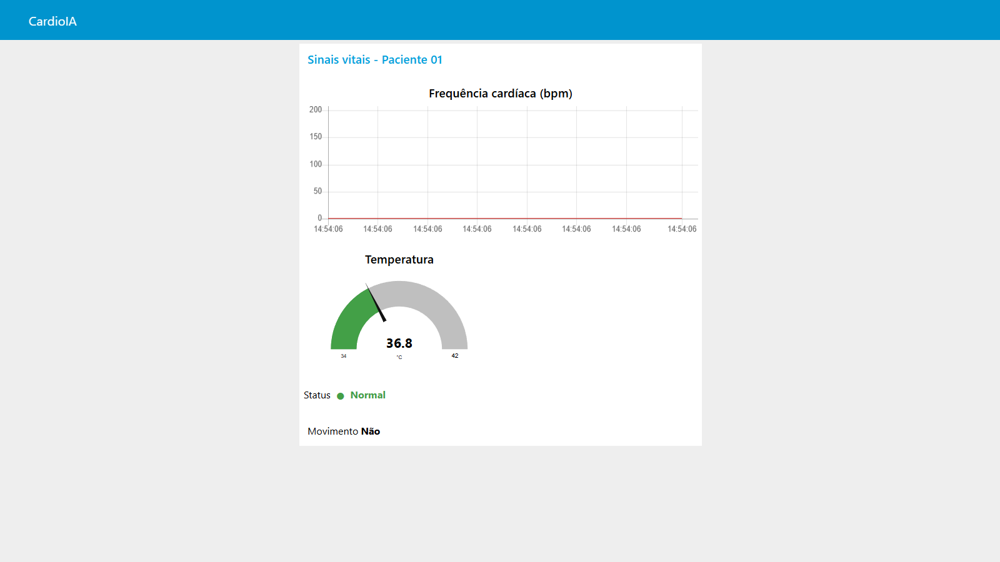
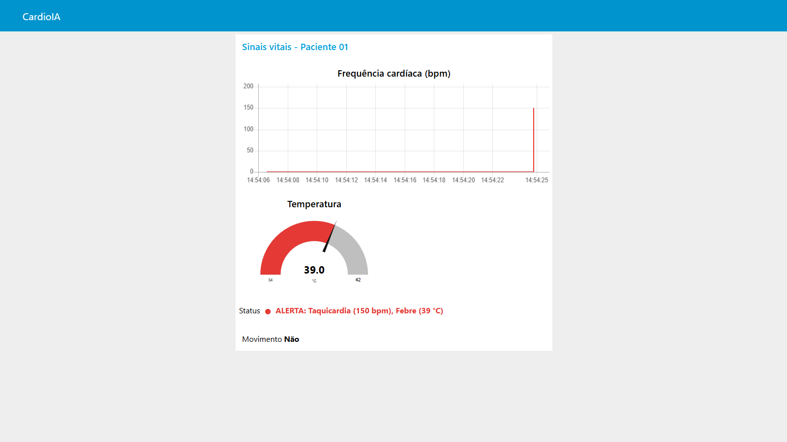
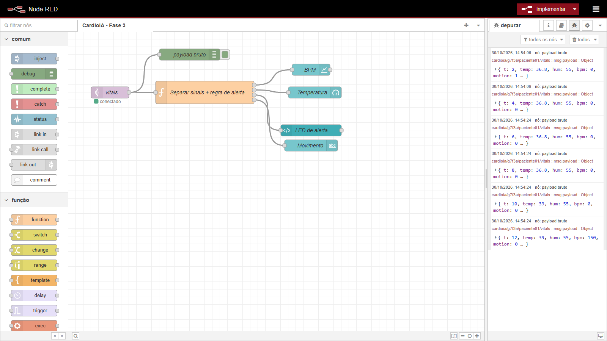
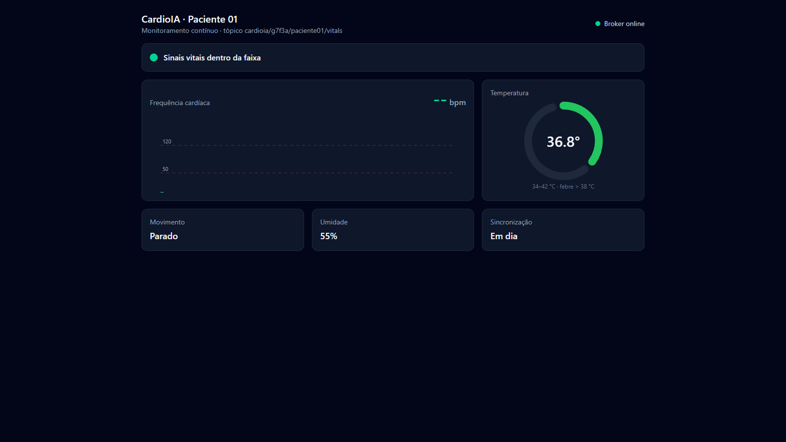
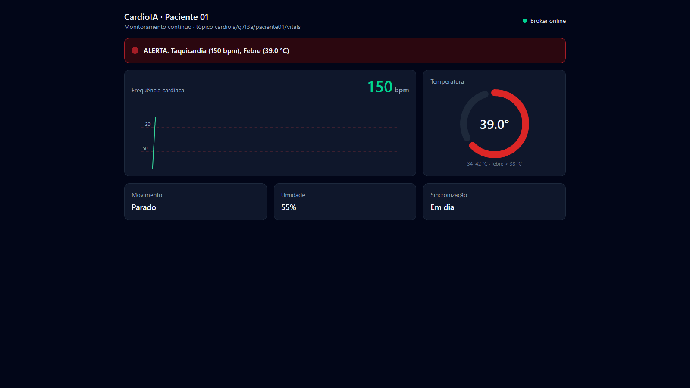

# Relatório – Parte 2: Transmissão para Nuvem e Visualização (Fog/Cloud Computing)

**Projeto:** CardioIA Conectada – Fase 3: Monitoramento Contínuo
**Arquivos:** [`wokwi/sketch.ino`](../wokwi/sketch.ino) · [`node-red/flow.json`](../node-red/flow.json)

## 1. Arquitetura

```
 ┌──────────────┐   MQTT publish   ┌──────────────────┐   MQTT subscribe   ┌──────────────────┐
 │    ESP32     │ ───────────────▶ │  Broker HiveMQ   │ ─────────────────▶ │     Node-RED     │
 │   (Edge)     │  QoS 0, JSON     │  (Cloud)         │  QoS 1             │  (Fog)           │
 │ sensores,    │                  │ broker.hivemq.com│                    │ regra de alerta, │
 │ buffer,      │                  │ porta 1883       │                    │ dashboard        │
 │ alerta local │                  └──────────────────┘                    └──────────────────┘
 └──────────────┘
```

- **Edge (ESP32):** captura, aplica a regra de alerta, guarda no buffer offline e publica.
- **Cloud (broker MQTT):** desacopla quem produz de quem consome. O ESP32 não sabe quem está ouvindo, e novos consumidores (Grafana, a API em Python do "Ir Além 1", um aplicativo médico) podem assinar o mesmo tópico sem alterar o firmware.
- **Fog (Node-RED):** camada intermediária que recebe os dados, revalida as regras clínicas e apresenta o dashboard.

**Laboratório local (Docker Compose):** para testar sem instalar nada além do Docker, `fase3/docker-compose.yml` sobe um Mosquitto local com *bridge* para o HiveMQ (assina só `cardioia/g7f3a/#`, o prefixo do grupo), o Node-RED já com o fluxo e o `node-red-dashboard`, e um painel web extra em React (porta 8080, recebe por MQTT sobre WebSocket na porta 9001). Assim, o que o ESP32 do Wokwi publica no HiveMQ chega ao Node-RED local pela ponte. Na bancada, o ESP32-S3 pode publicar direto no Mosquitto do PC.

## 2. Por que MQTT

O MQTT é um protocolo publish/subscribe sobre TCP, feito para dispositivos com pouca memória e redes instáveis:
- **Cabeçalho mínimo** (2 bytes), o que economiza bateria e banda em um vestível.
- **Conexão persistente:** o dispositivo abre uma conexão e publica várias vezes, ao contrário do HTTP, que exige uma requisição completa por mensagem.
- **QoS:** 0 (no máximo uma vez), 1 (pelo menos uma vez), 2 (exatamente uma vez).
- **Tópicos hierárquicos**, que permitem filtrar por paciente com curingas.

## 3. Configuração da comunicação

| Item | Valor |
|---|---|
| Broker | `broker.hivemq.com` (público, para a demonstração) |
| Porta | 1883 (TCP sem TLS) |
| Biblioteca | PubSubClient |
| Client ID | `cardioia-<MAC do ESP32>` (único por dispositivo) |
| Tópico | `cardioia/g7f3a/paciente01/vitals` |
| Frequência | 1 mensagem a cada 2 s, ou uma rajada na sincronização do buffer |
| Reconexão | nova tentativa a cada 5 s, sem bloquear a coleta |

**Hierarquia de tópicos:** `cardioia/<grupo>/<paciente>/<tipo>`. Com o curinga `cardioia/g7f3a/+/vitals`, um painel de enfermaria assina todos os pacientes de uma vez.

**Payload (JSON):**
```json
{"t":154,"temp":36.8,"hum":55,"bpm":78,"motion":1,"alert":0,"pending":0}
```

| Campo | Significado |
|---|---|
| `t` | segundos desde o boot (instante da coleta, não do envio) |
| `temp` | temperatura em °C |
| `hum` | umidade relativa em % |
| `bpm` | frequência cardíaca (0 = sem leitura) |
| `motion` | 1 se houve movimento nos últimos 3 s |
| `alert` | 1 se alguma regra clínica foi violada no Edge |
| `pending` | quantas amostras ainda faltam sincronizar |

**Entrega no lado do ESP32:** a amostra só sai do buffer depois que `mqtt.publish()` retorna `true`. Se a rede cair, os dados ficam no dispositivo e são reenviados quando a conexão voltar (ver Parte 1). Limitação: a PubSubClient publica apenas em QoS 0, então `true` significa "escrito na conexão TCP", não "confirmado pelo broker". Uma queda exatamente durante o envio pode perder aquela mensagem. Para entrega confirmada seria preciso QoS 1 (biblioteca `AsyncMqttClient` ou `esp-mqtt`), aguardando o PUBACK antes de remover a amostra.

## 4. Dashboard no Node-RED

**Pré-requisito:** Node-RED com o pacote `node-red-dashboard`. Para instalar: Menu → Manage palette → Install → `node-red-dashboard`.

**Importação:** Menu → Import → selecionar `node-red/flow.json` → Deploy. O dashboard fica em `http://localhost:1880/ui`.

**Nós do fluxo:**

1. **`mqtt in` (vitals):** assina `cardioia/g7f3a/paciente01/vitals` com QoS 1 e saída já convertida de JSON para objeto.
2. **`debug` (payload bruto):** mostra cada mensagem na barra lateral, útil para os prints de evidência.
3. **`function` (Separar sinais + regra de alerta):** tem 4 saídas e distribui cada sinal para o seu widget. Ela **revalida** os limites clínicos (BPM > 120, BPM < 50, temperatura > 38 °C) e monta o texto do alerta com o motivo. Repetir a regra no Fog é intencional: se o firmware de um dispositivo estiver desatualizado ou com defeito, o painel central continua aplicando a regra vigente.
4. **`ui_chart` (Frequência cardíaca):** gráfico de linha do BPM nos últimos 10 minutos, escala de 0 a 200. É o sinal vital pedido pelo enunciado.
5. **`ui_gauge` (Temperatura):** medidor de 34 a 42 °C com faixas de cor: verde até 37,5, amarelo até 38 e vermelho acima disso.
6. **`ui_template` (LED de alerta):** indicador visual de alerta (LED virtual). Mostra ● verde "Normal" ou ● vermelho "ALERTA: Taquicardia (135 bpm), Febre (38.6 °C)". Foi usado `ui_template` com `ng-style` porque o `ui_text` remove atributos de estilo e a bolinha não mudava de cor.
7. **`ui_text` (Movimento):** mostra "Sim"/"Não" e, durante uma sincronização, quantas amostras ainda estão chegando.

**Painel extra (React, `fase3/painel`):** além do dashboard do Node-RED (que é a entrega avaliada), há um painel web em `http://localhost:8080` que assina o mesmo tópico via WebSocket: gráfico de BPM com as faixas 50/120 tracejadas, medidor de temperatura, LED de status com o motivo do alerta, movimento, umidade e amostras pendentes de sincronização. Ele mostra outro consumidor do mesmo tópico funcionando sem nenhuma mudança no firmware.

## 5. Limites de alerta definidos pelo grupo

| Parâmetro | Limite | Condição clínica |
|---|---|---|
| BPM | > 120 | Taquicardia |
| BPM | < 50 (e > 0) | Bradicardia |
| Temperatura | > 38,0 °C | Febre |
| Movimento | 60 s sem detecção | Possível queda ou inconsciência (só no Edge) |

## 6. Segurança e boas práticas em IoT médico

O broker público foi usado para simplificar a demonstração. **Ele não é adequado para dados de saúde reais**: qualquer pessoa que assine o tópico consegue ler as mensagens. Para produção, e em conformidade com a LGPD, que trata dado de saúde como dado sensível:

- **TLS:** HiveMQ Cloud na porta 8883 com `WiFiClientSecure` e validação do certificado da CA.
- **Autenticação:** usuário e senha (ou certificado de cliente) por dispositivo, com ACL no broker restringindo cada dispositivo ao seu próprio tópico.
- **Pseudonimização:** o tópico usa identificadores (`g7f3a` para o grupo, `paciente01` para o paciente), nunca nome, CPF ou matrícula.

**O risco observado na prática:** ao conectar um cliente (MQTT Explorer) no lab, apareceram tópicos de outras equipes da turma sob o mesmo prefixo `cardioia/`, com mensagens retidas no broker público. Isso mostra os dois lados do problema: qualquer pessoa lê os nossos dados, e qualquer pessoa pode publicar no nosso tópico, o que geraria leituras e alertas falsos no dashboard. Como mitigação para a demonstração, o tópico ganhou um prefixo exclusivo do grupo (`cardioia/g7f3a/...`) e a ponte do lab passou a assinar só esse prefixo, sem importar dados de terceiros. A solução definitiva é a da lista acima: broker privado com TLS, autenticação e ACL por tópico.
- **Credenciais fora do código:** usar um `secrets.h` ignorado pelo git ou provisionamento seguro.
- **Minimização:** enviar só o necessário. O alerta é decidido no Edge, o que reduz a dependência da nuvem e o volume de dados.

## 7. Limitações conhecidas e próximos passos

- **Horário das amostras sincronizadas:** o gráfico do Node-RED desenha cada ponto na hora em que ele chega. Amostras sincronizadas em rajada aparecem amontoadas no momento da reconexão. O campo `t` guarda o instante real da coleta. A evolução é sincronizar o relógio por NTP e usar esse timestamp no eixo X (ou gravar em um banco de séries temporais, como InfluxDB + Grafana).
- **Grafana Cloud (opcional):** pode assinar o mesmo tópico via MQTT data source, sem mudar o ESP32.
- **Hardware real:** trocar o botão por um sensor de pulso óptico (MAX30102) e o buffer em RAM por LittleFS na flash de 16 MB.

## 8. Evidências

**Chegada no broker (lado nuvem → Fog):** durante a execução do cenário automático (ver Parte 1), um assinante no Mosquitto local registrou as mensagens trazidas do HiveMQ pela ponte ([`evidencias/broker-local.log`](evidencias/broker-local.log)):

```
cardioia/g7f3a/paciente01/vitals {"t":2,"temp":36.8,"hum":55,"bpm":0,"motion":1,"alert":0,"pending":1}
cardioia/g7f3a/paciente01/vitals {"t":4,"temp":36.8,"hum":55,"bpm":0,"motion":0,"alert":0,"pending":0}
cardioia/g7f3a/paciente01/vitals {"t":6,"temp":36.8,"hum":55,"bpm":0,"motion":0,"alert":0,"pending":3}
cardioia/g7f3a/paciente01/vitals {"t":8,"temp":36.8,"hum":55,"bpm":0,"motion":0,"alert":0,"pending":2}
cardioia/g7f3a/paciente01/vitals {"t":10,"temp":39.0,"hum":55,"bpm":0,"motion":0,"alert":1,"pending":1}
cardioia/g7f3a/paciente01/vitals {"t":12,"temp":39.0,"hum":55,"bpm":150,"motion":0,"alert":1,"pending":0}
```

As 6 mensagens publicadas pelo ESP32 chegaram, sem perda e na ordem, incluindo as 4 que estavam no buffer offline. Com esses dados, o dashboard mostrou o alerta "Febre (39 °C)" e o medidor de temperatura em 39,0 °C.

**Prints:** capturados durante a execução do cenário, com o firmware real do Wokwi alimentando o lab local.

**Dashboard Node-RED em estado normal** (36,8 °C, status verde, sincronizando a última amostra):



**Dashboard com alerta ativo**, depois da reconexão: as amostras do buffer chegaram, o gráfico mostra o salto para 150 bpm e o status traz os dois motivos:



**Aba debug do Node-RED** com os payloads JSON recebidos. As 4 últimas mensagens têm o mesmo horário de chegada (14:54:24): é a rajada de sincronização do buffer offline, com `t` (instante da coleta) em ordem crescente.



**Painel extra em React**, mesmo tópico e mesmo instante:

| Normal | Alerta |
|---|---|
|  |  |
