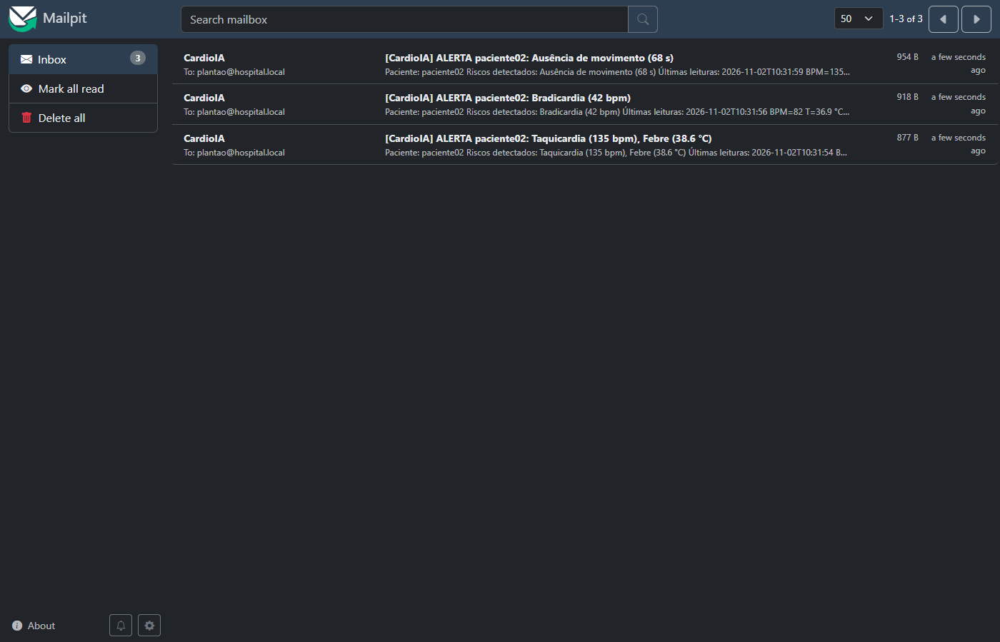
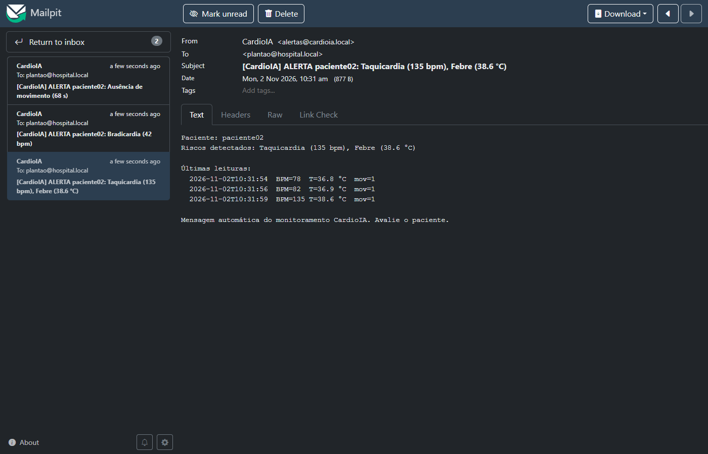
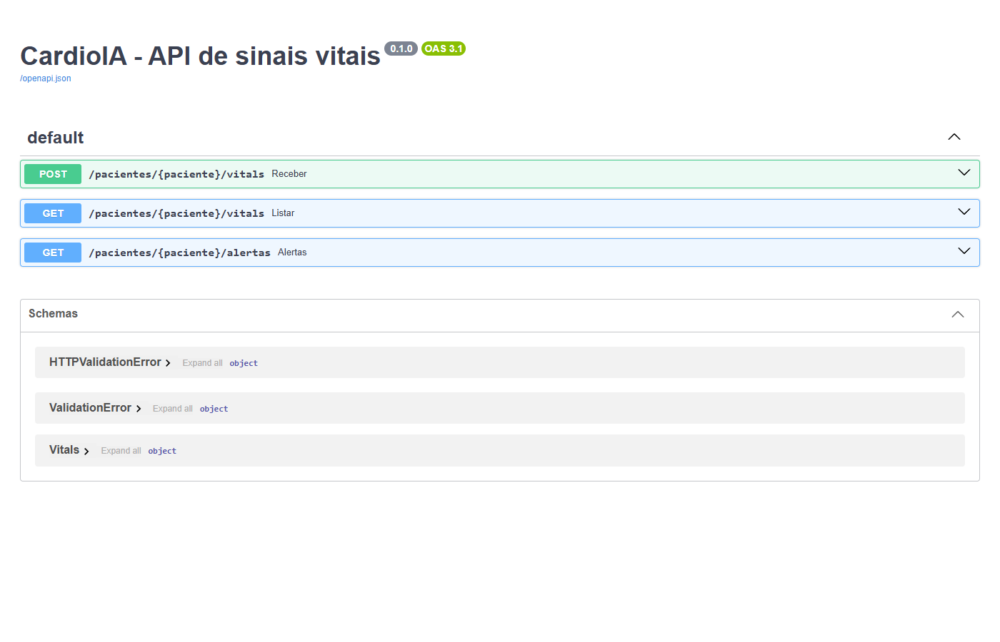

# FIAP - Faculdade de Informática e Administração Paulista

<p align="center">
<a href="https://www.fiap.com.br/">
  
</a>
</p>

<br>

# CardioIA Conectada – Ir Além 1: Comunicação automatizada com REST e e-mail

## 2TIAOR-2026

## 👨‍🎓 Integrantes:
- Giovani Saavedra – RM566797
- Marcio Elifas – RM567871

## 👩‍🏫 Professores:
### Tutor(a)
- Leonardo Ruiz Orabona
### Coordenador(a)
- André Godoi Chiovatto


## 📜 Descrição

Este módulo simula um sistema de monitoramento que **consome e envia sinais vitais por uma API REST em Python**, aplica uma **lógica de detecção de risco** e **dispara e-mails automáticos** quando surge um alerta. É uma automação no estilo RPA, aplicada à saúde digital.

**O fluxo:**
1. O ESP32 (Wokwi ou bancada) publica cada amostra no MQTT.
2. O **cliente REST** (`cliente.py`) assina o tópico e envia cada amostra para a **API** com **POST**.
3. A API (`api.py`, em FastAPI) guarda a amostra e responde com a avaliação de risco (`risco.py`):
   - taquicardia (BPM > 120);
   - bradicardia (0 < BPM < 50);
   - febre (> 38 °C);
   - ausência de movimento (60 s ou mais).
4. Se a resposta traz um **alerta novo**, o cliente busca as últimas leituras com **GET** e envia um e-mail para o plantão, com o motivo e o histórico recente.

O e-mail só é reenviado quando muda o **tipo** de risco, o que evita spam a cada 2 s. O envio é simulado com o **Mailpit**, um servidor SMTP de teste com caixa de entrada web: nenhum e-mail sai para a internet e nenhuma senha real fica no código.

Relatório completo, com evidências: [`../docs/relatorio-ir-alem-1-rest-email.md`](../docs/relatorio-ir-alem-1-rest-email.md).


## 📁 Estrutura de pastas

- <b>api.py</b>: API REST com as rotas:
  - `POST /pacientes/{id}/vitals`;
  - `GET /pacientes/{id}/vitals`;
  - `GET /pacientes/{id}/alertas`.
- <b>risco.py</b>: regras de risco, com autoteste (`python risco.py`).
- <b>cliente.py</b>: cliente REST (MQTT → POST/GET) e a automação de e-mail via SMTP.
- <b>Dockerfile</b> e <b>requirements.txt</b>: imagem usada pelos serviços `api` e `cliente-rest` do `docker-compose.yml`.
- <b>../docs/relatorio-ir-alem-1-rest-email.md</b>: relatório do fluxo implementado.
- <b>../docs/evidencias/</b>: evidências.
  - Prints `12-mailpit-caixa.png`, `13-mailpit-email.png` e `14-api-swagger.png`.
  - Log `cliente-rest.log`.


## 📎 Links e Observações

- <b>Documentação interativa da API (Swagger)</b>: http://localhost:8000/docs, com o lab em execução.
- <b>Caixa de e-mail de teste</b>: http://localhost:8025.
- <b>Decisão técnica</b>: a automação ficou em Python, e não no Node-RED. O Node-RED alerta quem está olhando o dashboard, e o cliente Python alerta quem não está (plantão). Os dois são independentes.

**Caixa de entrada:** 3 alertas distintos geraram 3 e-mails, sem repetição.



**E-mail de alerta:** traz o motivo e as últimas leituras, buscadas na API com GET.



**API REST (Swagger):**




## 🔧 Como executar o código

Pré-requisito: Docker Desktop.

```bash
cd fase3
docker compose up -d --build            # broker, Node-RED, API, cliente REST e Mailpit
docker compose logs -f cliente-rest     # acompanha as amostras e os e-mails disparados
```

Sem o ESP32, para testar, publique uma amostra com taquicardia:

```bash
docker compose exec mosquitto mosquitto_pub -t cardioia/g7f3a/paciente02/vitals \
  -m '{"t":6,"temp":38.6,"hum":55,"bpm":135,"motion":1,"alert":1,"pending":0}'
```

O e-mail aparece em http://localhost:8025.

**Sem Docker:**

```bash
pip install -r requirements.txt
uvicorn api:app --port 8000
python cliente.py
```

Para o cliente, as variáveis `MQTT_HOST`, `API_URL` e `SMTP_HOST` apontam para os serviços.


## 🗃 Histórico de lançamentos

* 1.0.0 - 02/11/2026
    * API REST, lógica de risco, cliente REST e e-mail via Mailpit

---


## 📋 Licença

<p xmlns:cc="http://creativecommons.org/ns#" xmlns:dct="http://purl.org/dc/terms/"><a property="dct:title" rel="cc:attributionURL" href="https://github.com/SabrinaOtoni/TEMPLATE-FIAP-GRAD-ON-IA">MODELO GIT FIAP</a> por <a rel="cc:attributionURL dct:creator" property="cc:attributionName" href="https://fiap.com.br">FIAP</a> está licenciado sobre <a href="http://creativecommons.org/licenses/by/4.0/?ref=chooser-v1" target="_blank" rel="license noopener noreferrer" style="display:inline-block;">Attribution 4.0 International</a>.</p>
