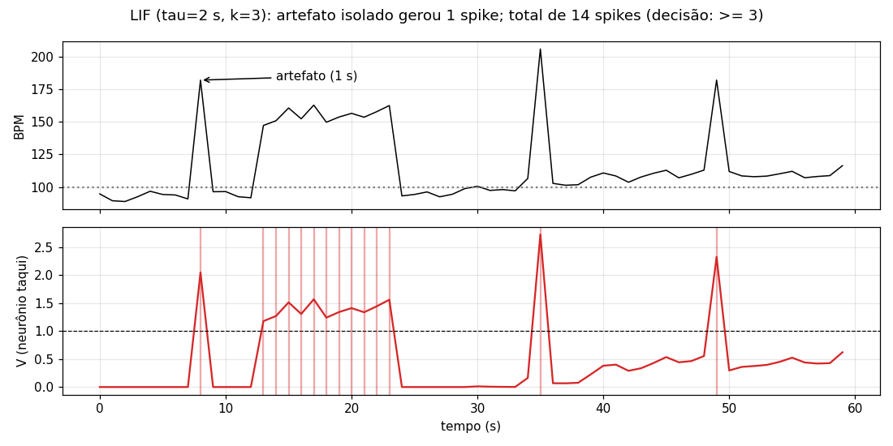
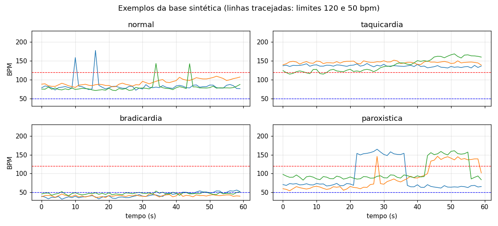
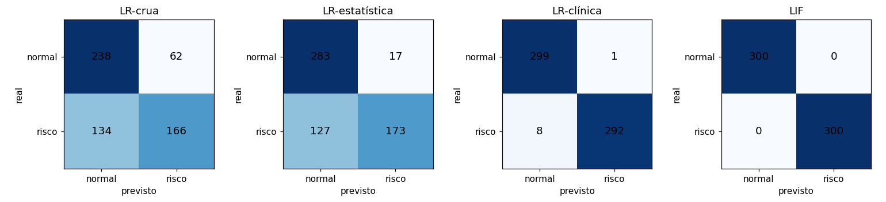
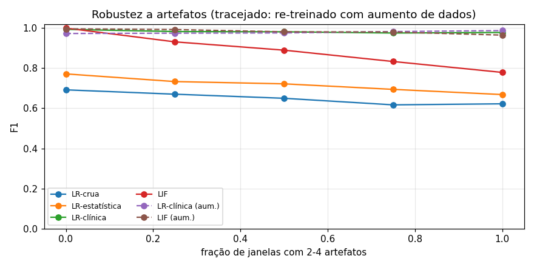
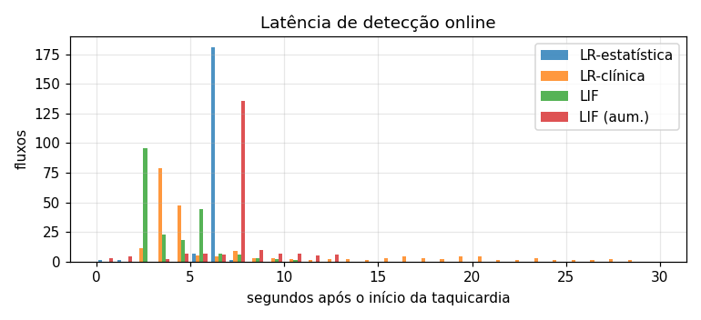

# FIAP - Faculdade de Informática e Administração Paulista

<p align="center">
<a href="https://www.fiap.com.br/">
  
</a>
</p>

<br>

# CardioIA Conectada – Ir Além 2: Inteligência Artificial em séries temporais de saúde

## 2TIAOR-2026

## 👨‍🎓 Integrantes:
- Giovani Saavedra – RM566797
- Marcio Elifas – RM567871

## 👩‍🏫 Professores:
### Tutor(a)
- Leonardo Ruiz Orabona
### Coordenador(a)
- André Godoi Chiovatto


## 📜 Descrição

O estudo aplica IA à **série temporal de frequência cardíaca** para detectar risco (taquicardia, bradicardia e crises curtas) em janelas de 60 s. A comparação é entre um **classificador tradicional**, a **regressão logística (LR)**, e uma **rede neuromórfica simples** de **2 neurônios LIF** (*Leaky Integrate-and-Fire*).

**Os dados** são 2000 janelas sintéticas, reprodutíveis (semente fixa), com:
- fisiologia plausível: variabilidade respiratória e deriva lenta;
- negativos difíceis: esforço físico até 115 bpm;
- **artefatos de sensor**: picos isolados, como um toque duplo no botão.

**Os modelos:**
- **LR em três versões:** com a série crua, com estatísticas genéricas e com atributos clínicos. A versão clínica recebe o mesmo conhecimento de domínio que o LIF, para que a comparação seja justa.
- **LIF:** cada neurônio integra o quanto o BPM sai da faixa normal (um para BPM alto, outro para BPM baixo), "vaza" com o tempo e dispara *spikes*. A janela é classificada como risco quando há pelo menos *k* spikes.

**Principais resultados:**
- Com atributos genéricos, a LR **não detecta bradicardia**, porque o risco é bimodal (alto **ou** baixo). Com atributos clínicos, ela atinge F1 = 0,985. O LIF atinge 1,0.
- O LIF detecta crises **em cerca de 3 s**, contra um p90 de 18 s da LR, com **2 variáveis de estado e cerca de 10 operações por amostra**. Ele cabe no próprio ESP32.
- O LIF com τ curto é sensível a artefatos (F1 0,78). Re-treinado com aumento de dados, chega a F1 0,965, mas leva 7 s para alertar. O par τ e k expõe de forma explícita o equilíbrio entre **latência e falso alarme**.

**Recomendação:** LIF no Edge, para o alerta local barato, e LR-clínica na nuvem, para dar a probabilidade e a explicação à equipe médica.


## 📁 Estrutura de pastas

- <b>cardioia_lif_vs_logistica.ipynb</b>: notebook comentado e já executado. Os resultados e gráficos ficam visíveis direto no GitHub.
- <b>requirements.txt</b>: dependências do notebook.
- <b>../docs/relatorio-ir-alem-2-ia.md</b>: relatório comparativo dos modelos.
- <b>../docs/evidencias/ir-alem-2/</b>: figuras geradas pelo notebook (exemplos, membrana do LIF, matrizes de confusão, robustez e latência).


## 📎 Links e Observações

- <b>Vídeo de apresentação (YouTube, não listado)</b>: https://youtu.be/gQoTYg0JhG8
- <b>Relatório comparativo</b>: [`../docs/relatorio-ir-alem-2-ia.md`](../docs/relatorio-ir-alem-2-ia.md)
- <b>Limitação</b>: a base é sintética. O próximo passo é validar com séries reais do PhysioNet (MIT-BIH) e com as leituras do ESP32 da bancada.

**Como funciona o neurônio LIF.** O neurônio funciona como um balde furado:
- **Enche** quando o BPM sai da faixa normal.
- **Vaza** com o tempo, pela constante τ.
- **Dispara um spike** quando transborda, e o balde esvazia.

No exemplo abaixo, a crise gera vários spikes seguidos. Já cada artefato isolado gera um só, e por isso a decisão exige pelo menos *k* spikes.



**Exemplos da base sintética:**



**Matrizes de confusão:** a LR com atributos genéricos não detecta bradicardia.



**Robustez a artefatos:** a linha tracejada mostra o modelo re-treinado com aumento de dados.



**Latência de detecção online:**




## 🔧 Como executar o código

Pré-requisito: Python 3.11+.

```bash
cd fase3/ir-alem-2
pip install -r requirements.txt
jupyter notebook cardioia_lif_vs_logistica.ipynb
```

Os dados são gerados no próprio notebook, sem download. A execução completa leva cerca de 1 minuto.


## 🗃 Histórico de lançamentos

* 1.0.0 - 02/11/2026
    * Notebook, relatório comparativo e figuras

---


## 📋 Licença

<p xmlns:cc="http://creativecommons.org/ns#" xmlns:dct="http://purl.org/dc/terms/"><a property="dct:title" rel="cc:attributionURL" href="https://github.com/SabrinaOtoni/TEMPLATE-FIAP-GRAD-ON-IA">MODELO GIT FIAP</a> por <a rel="cc:attributionURL dct:creator" property="cc:attributionName" href="https://fiap.com.br">FIAP</a> está licenciado sobre <a href="http://creativecommons.org/licenses/by/4.0/?ref=chooser-v1" target="_blank" rel="license noopener noreferrer" style="display:inline-block;">Attribution 4.0 International</a>.</p>
